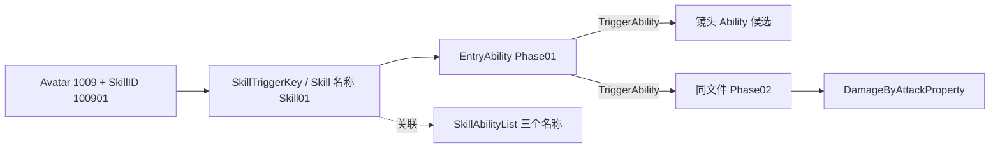

# 01 · Entity 与 Ability 配置模型

## 主数据身份与技能入口

实体身份可以用主数据主键、资源路径和类型标识分别描述。角色主数据的 `AvatarID` 是跨 Excel 表联接所需的身份，`JsonPath` 指定独立的角色行为配置，配置根的 `$type` 标识序列化结构。敌方以 `MonsterID` 和 `MonsterTemplateID` 分开表示实例配置与模板配置，忆灵另有 `ServantID`。BattleEvent 可携带 Ability 名称，也可借另一张表关联有技能列表的实体配置。身份的作用域和关系有原始字段支持，运行时对象布局仍为 **Unknown**。

| 对象 | 原始主数据节点 | 配置侧入口与定义候选 |
| --- | --- | --- |
| 艾丝妲，角色 1009 | `ExcelOutput/AvatarConfig.json# /7`，`JsonPath` 指向 Asta；`SkillList/0=100901`。`ExcelOutput/AvatarSkillConfig.json# /191` 的 Level 1、`SkillTriggerKey="Skill01"`，Level 2 为 `/192`。 | `Config/ConfigCharacter/Avatar/Avatar_Asta_00_Config.json# /SkillList/0` 的 `Name="Skill01"`、`EntryAbility="Avatar_Asta_00_Skill01_Phase01"`；匹配 `Config/ConfigAbility/Avatar/Avatar_Asta_00_Ability.json# /AbilityList/0`。 |
| 可可利亚武器，敌方 1002011 | `ExcelOutput/MonsterConfig.json# /0` 的模板 ID 1002011、`SkillList/0=100201101`；`ExcelOutput/MonsterTemplateConfig.json# /0/JsonConfig` 指向实体。技能 ID 见 `ExcelOutput/MonsterSkillConfig.json# /0` 的 `SkillTriggerKey="Skill04"`。 | `Config/ConfigCharacter/Monster/Monster_W1_CocoliaP1_01_Config.json# /SkillList/0/EntryAbility` → `Config/ConfigAbility/Monster/Monster_W1_CocoliaP1_01_Ability.json# /AbilityList/6`，名称 `Monster_Boss_Cocolia_P1_Weapon_Skill04_Phase01`。静态联接不能确定 AI 会选中的动作。 |
| 衣匠，忆灵 11402 | `ExcelOutput/AvatarServantConfig.json# /0` 包含 `Config` 路径和 `SkillIDList/0=1140201`，后者匹配 `ExcelOutput/AvatarServantSkillConfig.json# /0` 的 `SkillTriggerKey="Skill01"`。 | `Config/ConfigCharacter/Servant/Servant_AglaeaServant_00_Config.json# /$type` 为 `RPG.GameCore.ServantConfig`。其 `/SkillList/0` 标记 `SkillType="Servant"`，指向同名候选 `Config/ConfigAbility/Servant/Servant_AglaeaServant_00_Ability.json# /AbilityList/2`。 |
| 战斗事件 41001 | `ExcelOutput/BattleEventConfig.json# /151/BattleEventID` → `ExcelOutput/BattleEventData.json# /31`，后者有 `Config` 与 `SkillIDList/0=4100101`；`ExcelOutput/BattleEventSkillConfig.json# /39` 的 `SkillTriggerKey="Skill03"`。 | `Config/ConfigCharacter/BattleEvent/Avatar_RogueBattleevent120_Config.json# /SkillList/0/EntryAbility` → `Config/ConfigAbility/BattleEvent/Avatar_RogueBattleevent120_Ability.json# /AbilityList/1`。 |
| 战斗事件 1 | `ExcelOutput/BattleEventConfig.json# /0/AbilityList` 直接记录四个符号，其中 `/0/AbilityList/3="BattleEventAbility_ChallengeTurnLimit"`。 | `Config/ConfigAbility/BattleEventAbility.json# /AbilityList/9` 下 `/OnAdd/0` 为 `AddModifier`，目标 `Caster`，名称 `MCommon_ChallengeTurnLimit`。未找到同 ID 的 `BattleEventData` 行。 |
| 关卡 301001 | `ExcelOutput/StageConfig.json# /12/StageAbilityConfig/0="StageAbility_301001"`。同一行另有 `LevelGraphPath` 与 `MonsterList`。 | `Config/ConfigAbility/Level/Level_MazeChallengeBuff_Ability.json# /AbilityList/42` 下 `/OnAdd/0` 为 `AddModifier`，引用同 Ability 中定义的 `StageAbility_301001_Modifier`。 |

上述 JSON 字段和名称是 **Observed**。由 ID、路径和实体配置内唯一 `SkillTriggerKey → Name` 建立的联接为 **Derived**。角色配置中的 Ability 名称到另一个 Config 文件的同名匹配一般是静态候选。同表中的技能有多个等级行，需保留等级维度。机械联接包含空键、缺路径和同名歧义，详见清单与附表。回放、预览及其他分支资源也存在，主数据到资源的关联只证明当前工作树可定位哪些节点。

## Skill 与 Ability 组合

配置中至少有三种不同的 `AbilityList` 用法。 `ConfigCharacter` 根的字符串列表提供实体关联能力，`SkillAbilityList[n]/AbilityList` 提供某技能下的关联清单，`ConfigAbility` 根的对象列表定义具名 Ability。角色技能记录通过 `EntryAbility` 指向入口，部分记录另有 `PrepareAbility`。以配置项 `Name` 标识技能的同时也使用 `SkillType`、`UseType`、目标和标签，均可与执行节点分开查询。

艾丝妲普攻提供可证的一对多反例。以下摘录来自其角色配置 `/SkillList/0`、`/SkillAbilityList/0` 和 Ability 配置 `/AbilityList/0/OnStart/1`；去掉了无关字段。

```json
{"Name":"Skill01","EntryAbility":"Avatar_Asta_00_Skill01_Phase01"}
{"Skill":"Skill01","AbilityList":["Avatar_Asta_00_Skill01_Camera","Avatar_Asta_00_Skill01_Phase01","Avatar_Asta_00_Skill01_Phase02"]}
{"$type":"RPG.GameCore.TriggerAbility","TargetType":{"$type":"RPG.GameCore.TargetAlias","Alias":"Caster"},"AbilityName":{"Value":"Avatar_Asta_00_Skill01_Phase02"},"IsSkillPerform":true}
```

- **Observed** 同一入口的 `/OnStart/0` 请求 `Avatar_Asta_00_Skill01_Camera`，匹配 `Config/ConfigAbility/Avatar/Camera/Avatar_Asta_00_Camera.json# /AbilityList/0`。 `/OnStart/1` 请求同文件 `/AbilityList/1` 的 Phase02。后者的 `/OnStart/7` 为 `DamageByAttackProperty`，`/OnStart/8`、`/OnStart/11` 分别为 `DamagePerformFinish`、`SkillPerformFinish`。
- **Derived** 一条角色技能配置可列出多个 Ability，定义内也能显式请求其他 Ability。Asta 终结技 `/SkillList/2` 还有准备入口，`/SkillAbilityList/2` 列出四个关联能力。 `/AbilityList/5/OnStart/3` 请求 Phase02，`/AbilityList/6/OnStart/2` 给 `AllTeamMember` 施加同 Ability `/Modifiers/MAvatar_Asta_00_Ultra_SpeedUP`。局部 Modifier 的 `/_CallbackList/0` 选择 `OnStack` 并配置 `StackProperty` 改写 `SpeedDelta`。
- **Boundary** 存在仅 `Name,TargetInfo` 的条目，例如 `Config/ConfigAbility/RelicAbility.json# /AbilityList/0` 的 `RelicAbility100`。只有成员清单时，能力可能用于准备、镜头、终止清理或另一个触发入口。数组位置、同名匹配和 `Phase01/Phase02` 后缀均不足以判定调用同步性、命中顺序或每个条目都会执行。



### 技能分类与公共能力

在 `Config/ConfigCharacter` 的已索引条目里，显式 `SkillType` 有 `Passive,Skill,Ultra,Maze,Elation,Servant,Assist`。样本中普攻 `Skill01` 的 `SkillType` 缺失，仍有技能入口；缺失字段的默认枚举为 **Unknown**。艾丝妲战技与终结技、火花 `Config/ConfigCharacter/Avatar/Avatar_Sparxie_00_Config.json# /SkillList/5` 的欢愉技（`SkillType="Elation"`, `UseType="AutoUse"`）、衣匠的 `SkillType="Servant"` 都沿用 `SkillList → EntryAbility → AbilityList` 形态。火花的入口在其 `Config/ConfigAbility/Avatar/Avatar_Sparxie_00_Ability.json# /AbilityList/11/OnStart/2` 用通用 `TriggerAbility` 请求 Phase02，也通过相同类型请求镜头。普攻的 `AttackType`、对应 `SkillType` 与实际伤害任务属于不同字段层次。

姬子的追加攻击通过不同入口触发。 `Config/ConfigCharacter/Avatar/Avatar_Himeko_00_Config.json# /SkillList/3/EntryAbility` 指向天赋。 `Config/ConfigAbility/Avatar/Avatar_Himeko_00_Ability.json# /AbilityList/7/OnStart/0` 给 `Caster` 施加局部 Modifier `Avatar_Himeko_Passive1_Modifier`。其 `/AbilityList/7/Modifiers/Avatar_Himeko_Passive1_Modifier/_CallbackList/0/Event` 为 `OnListenAfterAttack`，同选择器下 `/CallbackConfig/0/SuccessTaskList/0/SuccessTaskList/0/SuccessTaskList/0` 是带 `AbilityTarget=AllEnemy` 与 `InsertAbilityPriority=AvatarInsertAttackSelf` 的 `TurnInsertAbility`。目标 `/AbilityList/8` 的成功分支在 `/OnStart/0/SuccessTaskList/7` 请求 `/AbilityList/9`，后者 `/OnStart/7` 仍为 `DamageByAttackProperty`。这是 **Derived** 的共享操作和事件→请求→Ability 链，与普通选择型技能的触发条件不同。配置无法确定实际调度器实现。

公共 `Avatar_Common_PassiveSkill` 的唯一核心候选在 `Config/ConfigAbility/Avatar/Avatar_Common_Ability.json# /AbilityList/0`，其 `/OnStart/0` 引用 `Local_SPAdd` 并传入 `MDF_AddValue.FixedValue.Value=10`。Asta、Himeko、Aglaea 与 Servant_AglaeaServant 的上述 `ConfigCharacter` 文件均在 `/AbilityList/0` 引用同名能力。公共索引 v1 中 `ConfigCharacter` 共有 671 个该名字的符号位置，包括同一实体的成员列表和多个技能入口。另一条公共能力 `Summoner_Common_PassiveSkill` 出现在 Aglaea 角色配置 `/AbilityList/1`，而衣匠对应位置是 `Servant_Common_PassiveSkill`。共享配置定义与角色专有符号同时存在。样本显示角色专有能力常由通用任务组合。玩法专用类型也可见，例如 `RPG.GameCore.CreateBattleEventFromGridFightBackend` 位于 `Config/ConfigAbility/BattleEvent/GridFight/4.7/AvatarAbility/BattleEvent_GridFight_S2_JingYuan_00_Ability.json# /AbilityList/0/OnAdd/0`。在这些证据下，全量类型均与角色或玩法无关的说法受到反例限制。类型名与角色名可分别查阅 02 清单，命名本身不足以证明底层硬编码。

## 参数、注入与替换

| 路径 | 最小原始定位与推导 | 阶段性结论 |
| --- | --- | --- |
| 技能等级参数 | Asta 的 `Config/ConfigCharacter/Avatar/Avatar_Asta_00_Config.json# /DynamicValues/Floats/-1126825319/ReadInfo`为 `{"Type":"SkillParam","TriggerKey":"Skill01","Index":0}`。对应 `Config/ConfigAbility/Avatar/Avatar_Asta_00_Ability.json# /AbilityList/1/OnStart/7/AttackProperty/DamagePercentage/PostfixExpr/DynamicHashes/0`。`ExcelOutput/AvatarSkillConfig.json# /191/ParamList/0/Value=0.5`，`/192/ParamList/0/Value=0.6`。终结技哈希 `812362065`、`242053466` 在同一 Character 配置将 `MDF_PropertyValue` 和 `LifeTime` 联到 `/215/ParamList` 的 36、2。 | **Derived** 参数读取由键、哈希和零基索引联接，数值是原始输入。结算后的属性和伤害为 **Unknown**。 |
| 行迹分支与能力 | `ExcelOutput/AvatarSkillTreeConfig.json# /487`，PointID 1009101，`PointTriggerKey="PointB1"`，`AbilityName=""`，参数 0.8、3、0.5。 Asta Ability 文件 `/AbilityList/1/OnStart/6/Predicate` 的 `BySkillPointActivated` 引用同键，成功分支中的 `AddModifier` 以 `-1761699449`、`-826297499` 连接概率、时长输入。 `/488/AbilityName="Avatar_Asta_SkillTree02"` 则有独立定义 `/AbilityList/9`，其 `/OnStart/0` 施加 `M_Asta_Tree02`。 | **Observed/Derived** 行迹可通过已有任务里的条件和输入参数影响行为，也有专门具名 Ability 入口。 |
| 星魂 | `ExcelOutput/AvatarRankConfig.json# /37/RankAbility/0="Avatar_Silwolf_Rank02"` → `Config/ConfigAbility/Avatar/Avatar_Silwolf_00_Ability.json# /AbilityList/11`，其局部 Modifier `M_Silwolf_Rank02_Buff` 的 `/_CallbackList/0` 包含 `OnEnterBattle`、`Priority=-80`。相邻 `/38` 的 `RankAbility=[]` 与 `SkillAddLevelList={"100602":2,"100604":2}` 表达另一类变化。艾丝妲 `ExcelOutput/AvatarRankConfig.json# /55` 的 `RankAbility=[]`、`Trigger.Hash=523552506` 与她的 Ability `/AbilityList/6/OnStart/4/Predicate/TriggerKey/Hash` 一致；成功任务挂 `MAvatar_Asta_00_Rank02Flag`。 | **Derived** 星魂可显式挂能力、改技能等级或走既有能力分支。其他角色共享哈希值的事实表明不能跳过实体作用域，银狼同阶 `/37/Trigger/Hash` 也是 523552506。 |
| 强化改版 | `ExcelOutput/AvatarConfig.json# /32` 和 `ExcelOutput/AvatarConfigEnhanced.json# /0` 同为 Avatar 1212，资源路径和 SkillID 集合不同。强化版 `SkillList/0=1121201` 联到 `ExcelOutput/AvatarSkillConfig.json# /4856`，`1121209` 联至 `/4866` 的 `Skill21`。`Config/ConfigCharacter/Avatar/Advanced/Avatar_Advanced_Jingliu_00_Config.json# /SkillList/0/EntryAbility` 与相应 Ability 文件 `/AbilityList/0` 匹配；相邻 `/SkillAbilityList/0/AbilityList/0` 仍与普通版共享镜头名字。 | **Derived** 身份与入口文件替换可同时存在，镜头等部件可留作共同候选。`AvatarEnhancedSkill.json# /0` 为对比文案记录，功能参数取自 `AvatarSkillConfig`。 |
| 战斗中替换 | `Config/ConfigAbility/Avatar/Advanced/Avatar_Advanced_Jingliu_00_Ability.json# /AbilityList/8/OnStart/10` 添加 `MAvatar_AdvancedAvatar_Jingliu_Attack_Transfer`。全局定义 `/GlobalModifiers/MAvatar_AdvancedAvatar_Jingliu_Attack_Transfer/_CallbackList/2/CallbackConfig/1` 指定 `SetControlSkillMapping(ControlSkill02,Skill21)`，该选择器是 `OnStack`。同 Modifier `/_CallbackList/0/CallbackConfig/1` 在 `OnDestroy` 配置 `ControlSkill02 → Skill02`。 | **Observed/Derived** 两个不同绑定及各自事件，`Skill21` 入口为上述强化镜流实体配置 `/SkillList/3/EntryAbility`，定位至对应 Ability 文件 `/AbilityList/9`。切换与 UI 刷新的内部一致性时序为 **Unknown**。 |

可复算参数脚本读取实际 JSON 指针。单哈希校验只检验参数绑定，其他表达式字节码、效果合成公式和 Rank/Point 在运行时的状态读取由 05 讨论。

## 装备、召唤和跨实体复用

- **Observed/Derived** `ExcelOutput/EquipmentConfig.json# /0` 的 `EquipmentID=20000`、`SkillID=20000` 联到 `ExcelOutput/EquipmentSkillConfig.json# /0` 的 `AbilityName="Ability20000"` 与 Level 1 参数 0.12、3。两个 Ability 资源中都有 `/AbilityList/1`，分别是 `Config/ConfigAbility/EquipmemtAbility.json`、`Config/ConfigAbility/Equip/EquipmemtAbility.json`。两者的同名条目均在 `/OnStart/0` 添加局部 `MEquip_20000_Main`，其 `/_CallbackList/0` 在 `OnStack` 配置 `StackProperty(CriticalChanceBase)`。 `Equip/` 版本 `/DynamicValues/Floats/-1330896030/ReadInfo` 显式是 `SkillEquip`、`Index=0`，回调使用 `AQAR`；根目录版本使用 `DynamicValues/Values` 且回调为 `AQAK`。这个同名反例说明名称匹配不足以判定参数结构等价或实际装载来源。
- **Observed/Derived** `ExcelOutput/RelicSetSkillConfig.json# /1` 的 SetID 101、`RequireNum=4` 提供 `AbilityName="Ability51011"`。根目录与 `Equip/` 子目录的 `RelicAbility.json# /AbilityList/1` 可匹配，样本均经 `/OnStart/0` 施加 `MRelic_101_Main`，其 `/_CallbackList/0/CallbackConfig/0` 受 `ByCompareWaveCount(Equal,1)` 约束，成功时 `ModifyTeamBoostPoint(Add,1)`。同 set 的 `/0` 两件套仅提供属性等主数据，`AbilityName=""`。由此不能假设每项装备效果必经 Ability 注入。
- **Observed/Derived** 阿格莱雅 `Config/ConfigAbility/Avatar/Avatar_Aglaea_00_Ability.json# /AbilityList/3/OnStart/1/SuccessTaskList/0` 的 `CreateServant` 固定 ID 11402，并传入 `Skill11_DamagePercentage` 等具名动态值；与忆灵主数据互证。忆灵动作的 `/AbilityList/2/OnStart/0` 请求 Phase02、`/AbilityList/3/OnStart/1` 为 `DamageByAttackProperty`，沿用通用任务。
- **Observed/Derived** 景元 `Config/ConfigAbility/Avatar/Avatar_JingYuan_00_Ability.json# /AbilityList/7/OnStart/4` 则使用 `CreateBattleEvent`，ID 11203，指定 `PropertyFromTarget=Caster`、`TeamLight` 及速度动态输入。 `ExcelOutput/BattleEventConfig.json# /42` 同 ID，具有 `EventSubType="DummyCharacter"`，`AbilityList` 对应景元文件中 `/AbilityList/9`、`/AbilityList/12`。主数据 `TeamNeutral` 与创建任务 `TeamLight` 同时存在，实际覆盖优先级无法由两处值确证。与 `CreateServant` 对照，可证召唤类机制有两条不同 ID 入口，后续行为均可关联具名 Ability。

## 生命周期、动画事件与引用图

核心定义的直接字段有 `OnStart`、`OnAdd`、`OnInsertAbort`、`OnRemove`。动作入口如 Asta 普攻在 `OnStart` 有任务，关卡或 BattleEvent 示例在 `OnAdd` 施加规则 Modifier。姬子的追加 Ability 在 `/AbilityList/8/OnInsertAbort` 配置插入取消相关任务。 `Config/ConfigAbility/Level/Level_Activity_ActivityTelevision_Ability.json# /AbilityList/6/OnRemove/0` 为 `RemoveModifier(Caster,MActivityTelevision_Wave_Ability_0001)`，该定义亦有 `OnAdd`。`Phase01/Phase02` 是名称约定，`OnStart` 等是结构字段，两者分别读取。`Tag` 和 `ServantWhiteList` 在少数定义可见，具体过滤和默认含义仍待解释。

`Config/ConfigAbility/Monster/Monster_W4_Claymore_02_Ability.json# /AbilityList/1/OnStart/2` 是 `{"$type":"RPG.GameCore.WaitAnimEvent","EventName":"Event_Skill01_Attack01"}`。其实体文件 `Config/ConfigCharacter/Monster/Monster_W4_Claymore_02_Config.json# /AnimEventConfigList/3` 引向 `Config/ConfigAnimEvents/Monster/Logic/Monster_W4_Claymore_02_Logic_AnimEvent.json`。该文件 `/LogicAnimEvents/0` 为 `{"EventName":"Event_Skill01_Attack01","AnimStateName":"Skill01","Time":0.320988}`。这是带实体导入证据的命名事件关联，数值单位与等待任务后续如何在运行时推进为 **Unknown**。艾丝妲普攻 `/AbilityList/1/OnStart/0` 使用 `WaitAnimState` 和 `NormalizedTimeEnd=0.2`，属于另一形态。未在核心索引定位 `MixAbility`、`MixTrigger` 的独立类型或同名已索引容器，已观察到的组合关系有 `SkillAbilityList`、请求任务、事件和模板。缺失命名不能用来排除未导出的结构。

[静态图与清单](inventory.md) 将技能入口、成员声明、安装、移除、数据引用和执行请求分列。同文件 `TriggerAbility` 字面符号有较强静态支持；跨文件候选、目标实体、父级条件、分支、等待与优先级继续约束可能的执行。核心仅由 Ability→Ability 请求的作用域选择边中已存在 14 个有环的强连通分量。一个可定位的自环是 `Config/ConfigAbility/Avatar/Avatar_Archer_00_Ability.json# /AbilityList/11/OnInsertAbort/1/SuccessTaskList/0/SuccessTaskList/0/SuccessTaskList/1/TaskList/2`，请求定义所在的 `Avatar_Archer_00_Insert_Phase01`，带 `PreCheck.Type="AbilityOwnerInsertUnusedCount"`、`Count.FixedValue.Value=1`。事件、内外条件和调度请求都参与约束，因此只确认静态请求边。实际次数、派发模型、线程、叠加和回调顺序仍为 **Unknown**。

## 命题与限制

| Claim ID | 等级 | 命题 | 反例或边界 |
| --- | --- | --- | --- |
| ABL-001 | Derived | 多种实体类别可由主数据 ID、实体配置路径、SkillTriggerKey 和 Ability 入口追踪。 | 无实体路径的事件 1 可直接列 Ability；技能入口的跨资源同名联接存在歧义。 |
| ABL-002 | Contradicted | 一个 UI 技能必须与一个底层 Ability 一一对应。 | Asta 普攻明确有三个成员，并请求镜头和效果子 Ability；通用被动还可在多个实体配置中出现。 |
| ABL-003 | Derived | Ability 配置结构和任务能跨普攻、施法、追击、忆灵和欢愉复用；具名局部配置和特殊原语也存在。 | SkillType、目标、入口及请求各承担不同角色。类型名只指向序列化标识。 |
| ABL-004 | Derived | 行迹、星魂、强化与装备至少有条件分支、参数、具名注入和运行时映射四种表达。 | 空 AbilityName、同时可见的同名装备资源、共享 Rank hash 都要求作用域和证据约束。 |
| ABL-005 | Unknown | Ability 运行调度与装载策略，包括同名资源选择、队列和栈优先级。 | Archer 自环和 Claymore 动画等待是局部配置证据。 |
