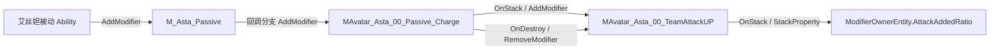

# 03 · Modifier 的作用域、生命周期与组合

## 发现与证据口径

**Observed**。常规战斗资料中有 22,729 个定义节点，分属 Ability 局部 `Modifiers` 15,127 个、资源内 `GlobalModifiers` 7,121 个、独立 `ModifierMap` 481 个，共 21,547 个不同名称。另在 `Config/Activity/RtBattle/` 和 `Config/Activity/RtDefence/` 识别同形定义 439 个。下文的「核心」限定为前一组。定义节点与名称计数分别使用原始文件指针与原始名称。所有示例编号对应 [可复算的源相对路径、JSON Pointer 和原文片段](evidence.jsonl)，单个表中多个编号指代不同的配置节点。

**Derived**。Modifier 的配置承担多个可独立观察的功能。状态被其他配置按名称查询，回调可执行通用战斗任务，行为旗标可参与移除和限制，属性写入可作为回调任务出现。形如 `MAvatar_Robin_00_Skill03Area_sub_disableAction` 的定义只包含 `{"BehaviorFlagList":["DisableAction"]}`，却有另一 Modifier 的显式施加与移除引用。包括应用及清理路径在内的静态分解使「Modifier 只能表达可见数值增益或减益」这一命题与样本矛盾。实际状态面板渲染与运行时实例字段仍未知。证据 M17–M19、M41、M45。

## 定义、名称和归属

| 出现形式 | 可确定的配置约束 | 例证与边界 |
| --- | --- | --- |
| `/AbilityList/i/Modifiers/<name>` | 字典键是配置身份的一部分，父 Ability 的名称独立。对同一文件、同一父 Ability 的同名调用可以给出作用域候选 | M07–M08、M09。Cocolia P2 与 `Monster_XP_Elite02_01` 都定义 `EnterBattleRage`，两者分别含 `TriggerAbility` 和 `TurnInsertAbility`。见 M27–M28 |
| `/GlobalModifiers/<name>` | 定义直接归属于资源文件。资源内的被动与回调可以复用该定义 | M10–M14。词缀 `Global` 本身无法决定加载到哪些实体、哪种同名定义会胜出 |
| `/ModifierMap/<name>` | 独立文件保存公共定义。与 Ability 内嵌定义共用一部分字段与任务类型 | M20–M23。实际资源注册条件未外推 |
| Excel 的状态条目 | 可观察到显示侧命名连接，`AvatarStatusConfig.json# /41` 用同名关联艾丝妲的充能状态 | M11 和 M15。Excel `StatusID` 不自动成为 Modifier 实例键 |
| 玩法变体 | RtBattle/RtDefence 使用同形映射并存在不透明任务及字段；DiceCombat 的近名概念是以 `ModifierID` 表达的数组 | M39–M40、M47。分开计数 |

核心索引还观察到 `HideMonsterHUD` 有 17 个定义，白盒测试的 `Modifier_WhiteBox_SummonerTest_OnAvatar` 同一文件中有 12 个局部定义。例如 `Config/ConfigAbility/Monster/Monster_W1_CocoliaP1_00_Ability.json# /AbilityList/28/Modifiers/HideMonsterHUD` 和 `Config/ConfigAbility/Monster/Monster_AML_Elite01_00_Ability.json# /AbilityList/11/Modifiers/HideMonsterHUD` 各自对应的添加节点均可在所属 Ability 内解析。**Contradicted**。全语料同名键必然指向同一配置。**Unknown**。不同 caster 共享一个持有者时，服务端去重键包括哪些身份，及每种 `Stacking` 细节。

### 施加者、持有者与参数

**Observed**。从艾丝妲 M07 的 `AllTeamMember` 写入，到 M08 的 `ModifierOwnerEntity` 读入属性任务，施加目标与回调执行时的持有者分别出现在配置两侧。公共 `StanceBreakState` 的同一 `OnCreate` 又分别把 `ModifierOwnerEntity` 用于添加和行动值偏移，把 `Caster` 用于 `TriggerBreak`，见 M20–M23 的父节点 `/_CallbackList/0/CallbackConfig/2`。常规添加的字段形态还包括 `InheritCaster`、`AsSubModifier`、`ReferenceModifierName` 与 `AliveOnly`。这些是不同配置槽位的证据，具体实例中别名的解析与继承规则仍未知。

艾丝妲终结技的局部传参可独立追踪。

1. **Derived**。角色行 `AvatarID=1009` 将技能 ID `100903` 与角色 Config 带入候选连接。对应技能行等级 1、`SkillTriggerKey="Skill03"`、`ParamList=[{"Value":36},{"Value":2}]`。角色 `Skill03` 的入口定义和 Phase01 内的命名调用对接 Phase02。证据 M01–M03、M06。
2. **Derived**。角色的 Float `812362065`、`242053466` 分别写明 `Type="SkillParam"`、`TriggerKey="Skill03"`、索引 0 与 1。Phase02 的添加任务分别以单动态引用写入 `DynamicValues.MDF_PropertyValue` 与 `LifeTime`。因此在所示等级的静态输入中，绑定的是 36 与 2。证据 M02、M04–M05、M07。
3. **Observed**。目标状态的回调对 `ModifierOwnerEntity` 写入 `SpeedDelta`，读另一个哈希 `2128130574`。该哈希也见 M08 上两级父状态的 `DynamicValues/Floats`。**Inferred**。这是施加参数到局部属性的接口。**Unknown**。本阶段未以源码验证文本键到哈希的规范，也未验证缺参 fallback、速度运算叠加规则及时间扣减。证据 M07–M08。

这个区分也用于艾丝妲充能链。M12 从源状态读取 `-1826473127` 并把表达式交给目标状态的具名参数；两段状态各自声明该数字键，M13 的接收方回调又把这个键与第二个键组合为 `AttackAddedRatio` 的表达式。由 M49–M50 可确定两个配置的声明均存在。具体局部值的生命周期和表达式运行时上下文没有由键名唯一决定。另一种显式写入是黄泉 `Config/ConfigAbility/Avatar/Avatar_Acheron_00_Ability.json# /AbilityList/19/OnStart/1`，用 `SetModifierDynamicValue` 向 `MAvatar_Acheron_00_ExRank01_HaloStatus` 的 `MDF_ShowInsertTime` 写值。两种路径对独立配置的带参施加与修改都有直接证据。

## 生命周期矩阵

数组顺序保留供核对。矩阵的行是独立配置接口与监听点，不定义跨回调的总执行序。

| 阶段 | 可观察配置 | 实例、例外与等级 |
| --- | --- | --- |
| 添加 | `AddModifier`、`ModifierName` 字符串或 `Value` 容器；可带 `DynamicValues`、`LifeTime`、`Chance`、`SuccessTaskList`、`FailTaskList`、`ResistedTaskList` | **Observed**。M07、M30。在添加指令上能传生命周期数据，并非只来自定义；未见字段时保留缺失 |
| 创建通知 | `_CallbackList[].Event="OnCreate"`；另有 `OnModifierAdd`、`OnListenModifierAdd`、`OnAddModifierSuc` 的选项 | **Observed**。M20–M22。添加、创建、堆叠通知之间的精确映射未知 |
| 激活与进入战斗 | `OnEnterBattle`、`OnPhase1`、`OnPhase2` 和不同的嵌套任务 | **Observed**。M27–M28 的父回调、M32、M37。独立激活状态机及 `OnStack` 是否总覆盖首次应用仍未知 |
| 重施与刷新 | `Stacking` 有 `Replace`、`ReplaceByCaster`、`ReplaceByCasterAbility`、`Refresh`、`Prolong`、`Multiple`、`Merge` 等原始值 | **Observed**。M11；`Config/ConfigAbility/Activity/Activity_FateReiju_Ability.json# /AbilityList/1/Modifiers/MActivity_FateReiju_02_Main/Stacking` 见 `Refresh`；[枚举与数值清单](policy-values.tsv)。实际替换时引用与回调是否保留未知 |
| 层数与值更新 | 定义或施加任务上出现 `Count`、`MaxLayer`、`LayerAddWhenStack`；监听 `OnStack` 与 `OnModifierOnStack`，并可显式 `SetModifierValue` | **Observed**。M11–M13、M36。缺省层数、边界与溢出策略不能从有无三个字段直接确定 |
| 回合和行动计时 | `LifeStepMoment` 观测值包括 `ModifierPhase1End`、`ActionPhaseEnd`、`TurnEnd`、`RoundEnd`、原文 `Unknow`；另有添加时 `LifeStepImmediately` | **Observed**。M11、M20、M42、M44。不同计时点并存的事实反驳所有状态都采用唯一可见扣减点；字段缺省与真实时钟仍 Unknown |
| Rt 玩法间隔 | `TickInterval` 为定义级字典，`RTMAvatar_Aventurine_00_StatTracker` 的原值为 `{"Value":0.5}` | **Observed**。M54。间隔单位、首次求值时点，以及它和该状态回调选择器的关系 Unknown |
| 延长与到期 | `SetModifierValue(ValueType="LifeTime", ModifyFunction="Add", Value=1)`；有 `OnDestroy` 清理 | **Observed**。M35、M14。前者的 `ParamModifier` 处于 `Remodifier.TaskList`，可解释为选中状态上下文的引用。自然到期触发路径与销毁原因字段未知 |
| 指名、依标记与自身移除 | `RemoveModifier`、`RemoveModifierByBehaviorFlag`、`RemoveSelfModifier` | **Observed**。M14、M19、M23、M41。目标、旗标及上下文三类入口有独立结构；是否立刻派发销毁回调未知 |
| 驱散 | `DispelStatus` 与显式 `OnDispel` 监听；可有筛选和 `IsSilentDispel` | **Observed**。M24、M48。取消被驱散对象的伴随状态与主动驱散具不同配置位置；没有现场运行证据证明两者的一次触发映射 |
| 离场与死亡清理 | `OnLeaveBattle`、`OnListenCharacterEscape`、`OnListenCharacterDie`；规则中出现 `RemoveWhenCasterDead` 与 `KeepOnDeathrattle` | **Observed**。M25、M41；`Config/ConfigAbility/Avatar/Avatar_BlackSwan_00_Ability.json# /GlobalModifiers/MAvatar_BlackSwan_00_DOT_Enhance/BehaviorFlagList` 含 `KeepOnDeathrattle`。实例移除、轮次销毁与跨波次残留是否普遍均 Unknown |

## 组合样本

### 计数器、属性与行迹分支

M09–M15 支持这张静态依赖图。充能节点 M11 的 `UIConfig` 是空对象，Excel 仍有同名状态记录。M11 的 `OnStack` 下第 2 项另外按 `BySkillPointActivated(PointB3)` 分支，仅成功分支含 `DefenceAddedRatio`、`StackStatusDesc`，成功及失败分支都含 `AttackAddedRatio`。见 `Config/ConfigAbility/Avatar/Avatar_Asta_00_Ability.json# /GlobalModifiers/MAvatar_Asta_00_Passive_Charge/_CallbackList/1/CallbackConfig/2`。**Derived**。同一状态组合计数写入、数值与描述更新、队友状态和销毁清理。**Unknown**。数组索引本身不规定可观察提交顺序。没有 UI 字段也不能推出在运行时隐藏。

### 行动限制、调用与实体间传播

- **Derived**。知更鸟的 `Skill03Area_sub` 自己的 `OnStack` 包含 `CreateBattleEvent` 和同文件 `DisableAction` 状态的施加，`OnDestroy` 指名移除；M16–M19。白厄的 `CharacterConfig.SkillList/4` 显式使用 `ByIsContainModifier` 作为 `UsableCondition`，说明已知一处角色技能入口以状态作为资格条件；M34。挑战活动的超冰回调还直接请求 `AttachSkillTypeDisable(Types=["Ultra"])`；M45。它们共同说明状态能够参与技能限制，不能据此把任何可用条件一概解释成技能替换。
- **Derived**。知更鸟的父状态 `Skill03Area` 还有声明式 `AdditionConfig.SubModifierList`，一项具名子状态由 `PointB2` 行迹判定、队伍目标和动态比率共同约束，并有 `IsHaloStatus: true`。子状态在同文件另行定义回调，见 M51–M52。相邻层中的回调施加和声明式关联均可指向其他状态；后者的目标更新频率与移除传播机制仍 Unknown。
- **Derived**。景元在状态回调中用 `TurnInsertAbility` 请求 `Avatar_JingYuan_00_Passive_Insert`，执行目标写成 `BattleEventCaster`，攻击目标为 `AllDarkTeam`，有两个 `AbortBehaviorFlags`。与此同时，M36 中另一状态的 `MaxLayer`、`LayerAddWhenStack` 从动态引用写入。状态既能持有计数配置又能参与行动请求，而 `TurnInsertAbility` 的触发顺序仍由其他证据限定。另有 Cocolia P2 的同文件阶段引用和另一相机候选，见 M27 的父回调。
- **Observed / Inferred**。遐蝶 `Remodifier` 选中具名角色状态并在其 `TaskList` 中，把 `InfectModifier.SourceType` 写为 `Caster`、`TargetType` 写为 `CasterServant`、`InfectType` 写为 `Override`、`UseParamModifierToInfect` 写为 `true`。M26 支持传递所选状态的语义解释，作用中的状态是复制、共享或重新实例化仍 Unknown。忆灵 `Servant_AglaeaServant` 另可用持有者上下文自身执行属性修改，见 M33。
- **Observed**。黄泉的回调含独立 `ModifySpecialSP`，并有 `OnAbilityPropertyChange` 下对特殊能量比例的判断。M38 及 `Config/ConfigAbility/Avatar/Avatar_Acheron_00_Ability.json# /AbilityList/15/Modifiers/MAvatar_Acheron_00_PassiveUltra/OnAbilityPropertyChange/0/Ranges/0/OnChange/1/SuccessTaskList/0/Predicate`。专属资源至少可通过独立操作表达；把每个专属资源都解释为 Modifier 层数，与配置结构冲突。
- **Observed**。阮·梅的延长击破状态同时使用 `OnDynamicValueChange` 的范围监听与 `_CallbackList.OnDispel` 去管理其他状态或表现。M24–M25、M46。两种监听形式共存于同一个配置，范围比较执行时点和同批写入时的派发次数未知。
- **Observed**。挑战活动的嘲讽将 `TargetSelectRestrictType` 设为 `EnemySelect`，限制目标槽引用 `Caster`，并配置 `KeepOnDeathrattle`、`RemoveWhenCasterDead`、`RemoveWhenCasterUnstage` 与显式 UI。M53。旗标同时引用施加者生命周期和状态处理环节，优先级及读写时序 Unknown。

### 跨装备和玩法

光锥以 `EquipmentSkillConfig.SkillID=20000` 给出 `Ability20000` 和等级参数。能力 `Config/ConfigAbility/EquipmemtAbility.json# /AbilityList/1` 的 `OnStart` 对 caster 施加局部状态，回调对 holder 使用 `StackProperty(CriticalChanceBase)`，见 M29–M31。装备目录下同名文件还有重复定义，故根目录和 `Equip/` 两份定义应分列。遗器 `Ability51061` 的状态在 `OnPhase1` 以持有者 HP 比例为条件，成功任务含治疗和能量修改，见 M32 及其所属 Ability 的 `OnStart/0`。与艾丝妲和忆灵的样本共享状态回调执行任务的表达。

实时玩法采用部分相同结构，但 `RtBattleAvatar_Aventurine_00_PassiveSkill01.OnAdd[1]` 使用 `AGPMEJILJBO`、`HILNFHCPEAD`、`IFNAGLOMHBK`、`FMCJJBALBEN`。**Derived**。其中 `IFNAGLOMHBK.Value` 指向本 Ability 中的唯一同名定义 `RTMAvatar_Aventurine_00_StatTracker`。**Inferred**。结合目标和参数形态，该节点近似具名施加操作。实际命令含义保留等级，其他持有该字段的匿名类型仍需逐个判定。参见 M39–M40、[Rt 命名字段候选](rt-symbol-candidates.tsv)。

## 静态引用图与限制

[图表](graph.tsv) 包含 57,979 条位置级引用，覆盖核心共享索引的 Ability→Modifier、Modifier→Modifier、Modifier→Ability。该边集同时包含操作、查询、条件和变量读取，需要通过 `parent_type` 区分。仅取同文件且 scope 匹配的 `AddModifier`、`RemoveModifier`，去除重复位置后，有 405 条自边与 121 条按较小指针计的相互指向操作边。例如艾丝妲充能回调创建队友状态并在销毁时移除同名队友状态，属于共享目标的多种边。图上的环需要结合实际回调、条件、目标和状态确认，无运行时无限递归结论。

[声明式子状态表](addition-candidates.tsv) 额外保留 `AdditionConfig.SubModifierList[].Name` 的每个候选链接及所在完整条目，包含目标、行迹／星魂条件、`IsHaloStatus` 和参数。该补集单列，避免和 v1 回调任务边的统计口径混用。

共享索引内有 6,780 个宽口径 unresolved Modifier 候选和 705 个 ambiguous 候选，含非核心域的字段。核心样本中 `Avatar_RuanMei_DelayHint` 的同名定义未匹配（M43），`ParamModifier` 则在 `Remodifier` 内有参数对象候选语义（M35）。二者都保留未解析。位于不同文件的唯一名称匹配只作为候选，`scoped` 指只根据当前文件和词法容器得到唯一目标。

**Inferred**。Active Effect 可以描述数值与寿命的部分样本，Behavior Component 可以描述限制、阶段和动作组合的一部分，Event Subscriber 可以描述监听与转发的一部分。三者都无法单靠配置证明官方运行时模块、实例内存结构或事件总线实现。公共定义的加载范围、UI 缺省策略、叠加的实例键、默认生命期、Callbacks 的派发与销毁时序仍是 **Unknown**。
