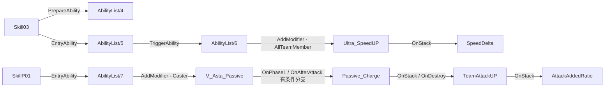

# 艾丝妲（1009）：全队速度状态与充能层

## 入口、参数和 Ability 图

**Derived**。角色编号来自 `ExcelOutput/AvatarConfig.json#/7`。其 `JsonPath` 指向 `Config/ConfigCharacter/Avatar/Avatar_Asta_00_Config.json`，技能表分别以 ID 100903 与 100904 连接该角色的 `Skill03`（终结技）与 `SkillP01`（被动）。一级技能行及配置坐标如下。

| 技能 | 技能表与入口 | 参数证据 |
| --- | --- | --- |
| 终结技 | `ExcelOutput/AvatarSkillConfig.json#/215`；角色配置 `/SkillList/2` 的 PrepareAbility 与 EntryAbility 分开 | `ParamList=[36,2]`（各值另包在 Value 对象中）。角色的 `/DynamicValues/Floats/812362065/ReadInfo` 与 `/DynamicValues/Floats/242053466/ReadInfo` 分别取 Skill03 的索引 0、1 |
| 被动 | `ExcelOutput/AvatarSkillConfig.json#/230`；角色配置 `/SkillList/3` 进入被动 | 参数为 0.07、5、3。入口施加局部状态时传入层数上限与消耗候选，后续 Charge 施加时另传入攻击比例 122195315，角色声明取 SkillP01／索引 0 |

下列 Ability 与 Modifier 的相对指针均基于 `Config/ConfigAbility/Avatar/Avatar_Asta_00_Ability.json`。箭头表示静态声明、请求或分支依赖。



## 速度状态与计数链

**Observed**。终结技 Phase01 的 `/AbilityList/5/OnStart/3` 请求 Phase02，另有独立镜头请求。Phase02 对队伍查询结果施加下面的局部状态，且把时长及属性改变量分开传递。所示为 `Config/ConfigAbility/Avatar/Avatar_Asta_00_Ability.json#/AbilityList/6/OnStart/2` 的节选。

```json
{
  "$type":"RPG.GameCore.AddModifier",
  "TargetType":{"$type":"RPG.GameCore.TargetAlias","Alias":"AllTeamMember"},
  "ModifierName":{"Value":"MAvatar_Asta_00_Ultra_SpeedUP"},
  "LifeTime":{"IsDynamic":true,"PostfixExpr":{"OpCodes":"AQAR","FixedValues":[],"DynamicHashes":[242053466]}}
}
```

**Derived**。同一任务的 `DynamicValues.MDF_PropertyValue` 读 812362065。以上同键静态联接使施加点获得 36、2。 `/AbilityList/6/Modifiers/MAvatar_Asta_00_Ultra_SpeedUP/_CallbackList/0` 的 OnStack 对 `ModifierOwnerEntity` 配置 `StackProperty(SpeedDelta)`，读取 2128130574。该哈希和具名实参的对应还得到独立 [文本哈希实验](../05-context-expression/hash-probe.md) 支持。实际会经过哪些回合边界仍为 **Unknown**。

**Observed**。被动的 `/AbilityList/7/OnStart/0` 先在结构上装配局部状态 `M_Asta_Passive`。后者的 OnAfterAttack 对 `AttackTargetList` 使用 `Retarget`，显式标注 `ByRandom=true` 和 `IncludeLimbo=true`；再用 `ByHasStanceWeak` 检查 `ParamEntity` 的火弱点，两个分支各有计数处理及状态添加。成功分支的具名施加可从 `Config/ConfigAbility/Avatar/Avatar_Asta_00_Ability.json#/AbilityList/7/Modifiers/M_Asta_Passive/_CallbackList/1/CallbackConfig/0/TaskList/0/SuccessTaskList/2` 回读。本状态的 OnPhase1 另设星魂标记和 `MDF_Count > 0` 等谓词，进入不同的重施、移除路径。见 [Modifier 证据 M09–M14](../03-modifier/evidence.jsonl)。

**Derived**。 `/GlobalModifiers/MAvatar_Asta_00_Passive_Charge` 声明 `Count=5`、`ReplaceByCaster` 和 `LifeStepMoment="ModifierPhase1End"`。其 `_CallbackList/1` 为 OnStack，含 `SetModifierValue` 和给 `AllTeammateWithUnselectable` 添加 TeamAttackUP 的任务。在 TeamAttackUP 的 OnStack 中，`StackProperty` 对持有者写 `AttackAddedRatio`，表达式带两个哈希。Charge 的 `_CallbackList/0` 为 OnDestroy，其中的 `RemoveModifier` 用合并查询移除 TeamAttackUP。两条关系和星魂、行迹分支共同表明，状态可承担计数和分发属性效果的职责。

## 配置偏序与残差

- **Derived**。入口依赖限定 Phase02 的具名可达关系。OnAfterAttack 的 Retarget 结果是其内部火弱点判定的输入，成功与失败路径由谓词限定。OnStack 与 OnDestroy 体内各有绑定的任务，配置没有提供不同监听者之间的总序。
- **Inferred**。被动通过层值和具名队伍状态持续传播攻击属性，终结技则给队伍成员另设速度状态。叠层读值的取整、随机选择次数、角色失去可选状态时的运行时筛选、首次应用是否与 OnStack 一起派发，以及同名状态跨施加者的叠加均为 **Unknown**。
- 主要 Ability 与状态在本资源内静态可达。镜头 Ability 为独立资源候选。两输入表达式的算术解释是有限候选，未用于反推实战攻击属性或最终伤害。

[技能入口](../01-entity-ability/report.md) · [原子操作](../02-atomic-operations/report.md) · [Modifier 生命周期](../03-modifier/report.md) · [事件模型](../04-callback-trigger/report.md) · [执行上下文](../05-context-expression/report.md)
