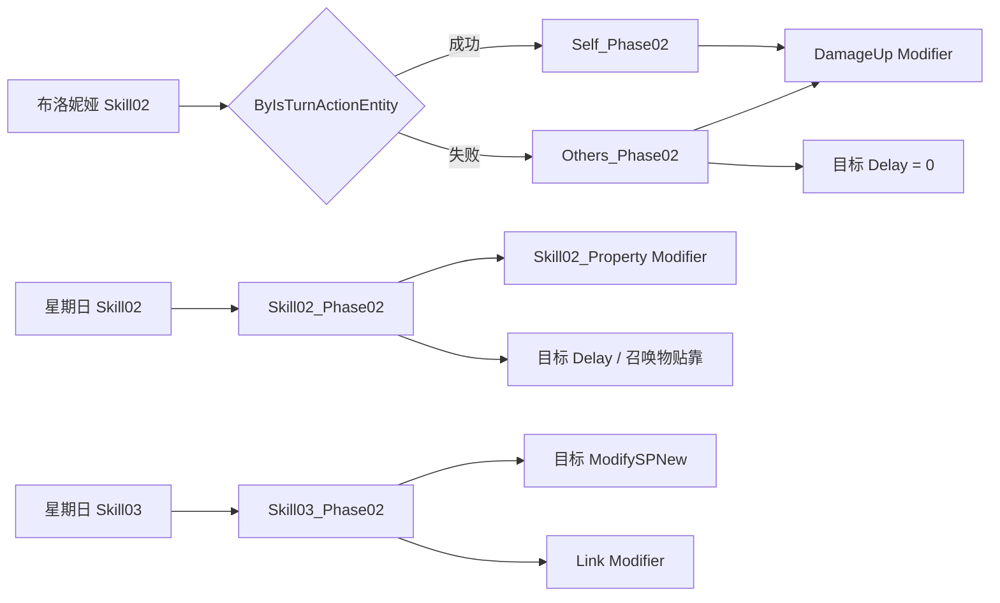

# 布洛妮娅与星期日：目标路由、行动延迟与恢复能量

## 入口与 Ability 关系

| 角色 | 主数据到技能 | 配置中的静态请求 |
| --- | --- | --- |
| 布洛妮娅 1101 | `ExcelOutput/AvatarConfig.json#/9` 指向 `Config/ConfigCharacter/Avatar/Avatar_Bronya_00_Config.json#/SkillList/1` 的 Skill02（FriendSelect）；`ExcelOutput/AvatarSkillConfig.json#/312` 为技能 110102 一级，ParamList 为 0.33、0、1、1 | `Config/ConfigAbility/Avatar/Avatar_Bronya_00_Ability.json#/AbilityList/2/OnStart/0` 根据 ByIsTurnActionEntity 请求同文件 /AbilityList/4 或 /AbilityList/3；两支各有镜头请求 |
| 星期日 1313 | `ExcelOutput/AvatarConfig.json#/55` 指向 `Config/ConfigCharacter/Avatar/Avatar_Sunday_10_Config.json#/SkillList/1` 和 `Config/ConfigCharacter/Avatar/Avatar_Sunday_10_Config.json#/SkillList/2`；`ExcelOutput/AvatarSkillConfig.json#/3714` 与 `ExcelOutput/AvatarSkillConfig.json#/3729` 分别为技能 131302 和 131303 一级 | 战技 /AbilityList/2 的 OnStart/3 请求 /AbilityList/3，终结技 /AbilityList/5 的 OnStart/2 请求 /AbilityList/6，定义同在 `Config/ConfigAbility/Avatar/Avatar_Sunday_10_Ability.json` |

**Derived**。Ability 路径可按入口名与具名请求串起。下图中的分支为配置条件，效果节点表示可达任务。



## 布洛妮娅：根据当前行动实体分流

**Observed**。入口谓词指定 `AbilityTargetEntity`。真分支请求 Self 命名的 Ability，假分支请求 Others。这个判定的原始类型为 `ByIsTurnActionEntity`，从配置能知道它选择哪个请求。两路均含 `DispelStatus`、星魂谓词和伤害状态施加。下方的置零任务仅在所查 Others_Phase02 的对应任务清单内，目标仍是预先选出的能力目标。原节点 `Config/ConfigAbility/Avatar/Avatar_Bronya_00_Ability.json#/AbilityList/3/OnStart/6`。

```json
{"$type":"RPG.GameCore.SetActionDelay","TargetType":{"$type":"RPG.GameCore.TargetAlias","Alias":"AbilityTargetEntity"},"Value":{"IsDynamic":false,"FixedValue":{"Value":0}}}
```

**Derived**。Others 的 `/AbilityList/3/OnStart/4` 按 Rank06 选择同名状态的两种时长表达式；Self 在 `/AbilityList/4/OnStart/5` 有对应分支。普通时长读 1483309121，由角色 `DynamicValues.Floats` 联到 Skill02 索引 2（一级为 1）；伤害实参读 147328743，对应索引 0（0.33）。额外时长 1727293081 读 Rank06 索引 0，布洛妮娅所属 RankID 110106 的 `ExcelOutput/AvatarRankConfig.json#/71/Param/0/Value` 为 1。两输入相加得到时长候选 2 属 **Inferred**。全局状态 `Config/ConfigAbility/Avatar/Avatar_Bronya_00_Ability.json#/GlobalModifiers/MAvatar_Bronya_00_BPSkill_DamageUp/_CallbackList/0` 在 OnStack 用 `StackProperty` 对持有者写 `AllDamageTypeAddedRatio`。调度任务不带伤害属性修改参数，属性任务另在状态监听体执行。

## 星期日：目标关联实体与终结技恢复

以下指针均基于星期日 Ability 文件。**Observed**。战技 `/AbilityList/3/OnStart/5` 在 PointB3 条件体下，对友方目标及条件允许的召唤物配置驱散。 `/AbilityList/3/OnStart/6` 检查目标类型 Avatar，并在对应分支按 `AbilityTargetEntity.GetServantAndDummyCharacter` 的计数，选用不同的参数表达式。目标使用 `AbilityTargetEntity + AbilityTargetServantOrSummoner` 或直接 AbilityTargetEntity。公共 `Config/GlobalConfig/TargetAliasConfig.json#/AliasDict/AbilityTargetServantOrSummoner` 把前一别名定义为 `AbilityTargetEntity.GetSummoner | AbilityTargetEntity.GetServant`，保存了双向关联查询。目标类型 Shaman 的反转谓词在 `/AbilityList/3/OnStart/9` 门控对选中目标的 `SetActionDelay(0)`。随后显示的另一个配置位置 `/AbilityList/3/OnStart/10` 还有 `ByIsForbidChangeOthersActionDelay`，由其成功条件控制将两类召唤相关实体放到该目标的 `NearType="After"`，操作类型为 `SetActionDelayNearTarget`。

**Derived**。星期日战技参数行 `/3714` 的索引 1、2、3 为 0.15、2、0.25，对应角色自己的哈希 936398762、-1019408300、-1204468266。局部状态 `Config/ConfigAbility/Avatar/Avatar_Sunday_10_Ability.json#/AbilityList/3/Modifiers/MAvatar_Sunday_10_Skill02_Property/_CallbackList/0` 用 OnStack 把属性表达式写向持有者，`StackProperty.Property="AllDamageTypeAddedRatio"`。两输入分支包含 0.15 与 0.25，依据已验证的同形候选可读出相加 0.40 的 **Inferred** 输入值，实际属性合成留空。

**Derived**。终结技 `/AbilityList/6/OnStart/4` 从技能目标读取 MaxSP 至 `_MAXSP`。 `/OnStart/5` 用两个哈希写 `_Skill03_AddSPAmount`，其中 172314977 读一级终结技索引 0 的 0.2； `/OnStart/6` 在 PointB1 激活且中间值小于门槛时覆盖该键，哈希 -623394267 读 `ExcelOutput/AvatarSkillTreeConfig.json#/3087/ParamList/0/Value` 的 40； `/OnStart/8` 请求对 AbilityTargetEntity 执行 `ModifySPNew`。候选文本哈希的计算结果 `_MAXSP → -1087634200`、`_Skill03_AddSPAmount → -1835820702` 均见于相应消费者的表达式。把下限分支解释为对目标最大能量乘比例所得值设最小值属于 **Inferred**。同时，`/OnStart/10` 在目标与 Caster 不同的分支撤旧 Link，并按召唤关联选择目标；`/GlobalModifiers/MAvatar_Sunday_10_Skill03_Link/_CallbackList/1` 的 OnStack 给持有者写 `CriticalDamageConvert`。

## 约束与未知

回调与条件限定任务可达范围。星期日的最大能量读取、具名中间值与下限检查构成静态数据依赖。布洛妮娅直接置零与星期日额外的相对行动请求展示同类基础操作可由不同目标过滤和条件组合。**Unknown** 包括数值零的真实调度优先级、并列行动的顺序、运算符 +／-／| 的全部目标集合语义、省略目标的默认处理，以及标准能量任务对各专属资源的运行时行为。具名本地效果的图边均已匹配；独立镜头资源及通用目标管道执行留给各专题。

[操作类型](../02-atomic-operations/report.md) · [状态回调](../03-modifier/report.md) · [上下文和静态求值](../05-context-expression/report.md) · [行动与资源](../06-resource-scheduling/report.md)
