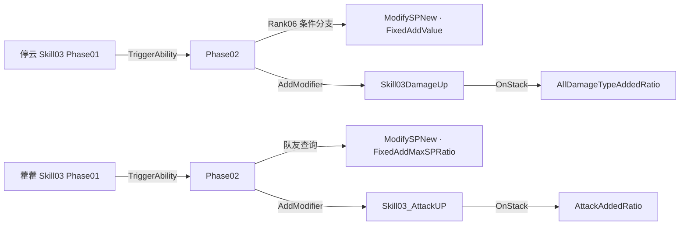

# 停云与藿藿：固定量与目标最大能量比例

## 主数据、技能入口、Ability 请求

| 角色 | ID 与角色入口 | 终结技一级参数、请求与目标 |
| --- | --- | --- |
| 停云 | `ExcelOutput/AvatarConfig.json#/22` 的 AvatarID 1202、SPNeed 130、技能 120203；`Config/ConfigCharacter/Avatar/Avatar_Tingyun_00_Config.json#/SkillList/2` 声明 Skill03 与 FriendSelect | `ExcelOutput/AvatarSkillConfig.json#/940` 的参数 50、2、0.2；`Config/ConfigAbility/Avatar/Avatar_Tingyun_00_Ability.json#/AbilityList/5/OnStart/5` 请求同文件 /AbilityList/6 |
| 藿藿 | `ExcelOutput/AvatarConfig.json#/36` 的 AvatarID 1217、SPNeed 140、技能 121703；`Config/ConfigCharacter/Avatar/Avatar_Huohuo_00_Config.json#/SkillList/2` 声明 Skill03 与 AllTeamMember | `ExcelOutput/AvatarSkillConfig.json#/2045` 的参数 0.15、0.24、2；`Config/ConfigAbility/Avatar/Avatar_Huohuo_00_Ability.json#/AbilityList/5/OnStart/1` 请求同文件 /AbilityList/6 |

**Derived**。该版本可用角色 ID 范围、各自主数据的技能 ID、触发键和 Ability 名建立静态链。两个角色的配置都分开请求镜头 Ability，图中显示与能量和属性有关的效果节点。



## 固定量与星魂条件

**Observed**。停云 Phase02 的 `/AbilityList/6/OnStart/7` 使用 `ByRankActivated`（Hash -1445815962）。两支均对 AbilityTargetEntity 配置 `ModifySPNew`，Tag 均为 `{"EnumIndex":6,"Value":1}`。失败分支原节点为 `Config/ConfigAbility/Avatar/Avatar_Tingyun_00_Ability.json#/AbilityList/6/OnStart/7/FailedTaskList/0`。

```json
{
  "$type":"RPG.GameCore.ModifySPNew",
  "TargetType":{"$type":"RPG.GameCore.TargetAlias","Alias":"AbilityTargetEntity"},
  "Tag":{"EnumIndex":6,"Value":1},
  "FixedAddValue":{"IsDynamic":true,"PostfixExpr":{"OpCodes":"AQAR","FixedValues":[],"DynamicHashes":[-1349665456]}}
}
```

**Derived**。-1349665456 从角色 DynamicValues.Floats 读取 Skill03 索引 0，一级为 50。星魂真分支的第二个哈希 -1752447704 读 Rank06 索引 0。 `ExcelOutput/AvatarConfig.json#/22/RankIDList/5` 为 120206，由所属角色范围连到 `ExcelOutput/AvatarRankConfig.json#/149/Param/0/Value` 的 10。相邻角色的 `ExcelOutput/AvatarRankConfig.json#/143` 含同一触发哈希但不同 RankID 120106，因此不能按哈希独立选键。两输入表达式 `AQABAQIR` 的加法候选得到 60，标 **Inferred**。这两项是入参，不给出目标应用后的实际能量。

**Derived**。 `Config/ConfigAbility/Avatar/Avatar_Tingyun_00_Ability.json#/AbilityList/6/OnStart/9` 独立施加局部 DamageUp，时长 242053466 读 Skill03 索引 1 的 2，伤害实参 1621744260 读索引 2 的 0.2。局部状态 `/AbilityList/6/Modifiers/MAvatar_TingYun_00_Skill03DamageUp/_CallbackList/0` 在 OnStack 对持有者执行 `StackProperty(AllDamageTypeAddedRatio)`。Phase02 还有作用于 Caster、配置 `AddRatio=1` 的独立 `ModifySPNew`，缺少上下文证据时保留该值的运行时用途为 **Unknown**。

## 按目标最大值比例和不同受益范围

**Observed**。藿藿的 `Config/ConfigAbility/Avatar/Avatar_Huohuo_00_Ability.json#/AbilityList/6/OnStart/1` 使用同一原语和同一 Tag，改用 `FixedAddMaxSPRatio`，以 -668390952 读取 Skill03 参量索引 0，即 0.15。公共 `Config/GlobalConfig/TargetAliasConfig.json#/AliasDict/AllTeammateOnlyAddSPOnceForServant` 将查询写成 `AllTeammate - AllTeammate.GetServant`。 `AllTeammate` 自身通过 Caster 与 ParamEntity 交集的反转过滤从 AllTeamMember 取目标。配置展示关联实体的筛选意图，操作符和运行时事件去重仍为 **Unknown**。

**Derived**。同 Ability 的 `/AbilityList/6/OnStart/3` 使用较宽的 `AllTeammate`，向全局 `MAvatar_Huohuo_Skill03_AttackUP` 传 750216344 和 238783065，分别读 Skill03 索引 1、2 的 0.24 与 2。 `Config/ConfigAbility/Avatar/Avatar_Huohuo_00_Ability.json#/GlobalModifiers/MAvatar_Huohuo_Skill03_AttackUP/_CallbackList/0` 为 OnStack，任务对持有者写 `AttackAddedRatio`。因此能量的目标过滤、攻击增益的目标查询、Modifier 时长与属性值四个接口在同一 Ability 内各自可定位。

## 偏序、后续与残差

入口请求、Rank06 真/假分支和状态 OnStack 主体提供静态因果约束。**Inferred**，标准能量的相同 Tag 可供其他状态监听，作为独立路由证据，白厄的 `OnSPChange` 监听中出现同形枚举，见 [资源专题的白厄样本](../06-resource-scheduling/report.md)。本案具名效果状态均定位到本资源，公共目标别名有定义。目标的特殊资源如何接收或拒绝、最大能量取样时点、正增量是否被上限裁切、事件能否合并、恢复与属性应用的跨目标总序，均为 **Unknown**。

[Ability 和参数](../01-entity-ability/report.md) · [操作](../02-atomic-operations/report.md) · [状态](../03-modifier/report.md) · [事件结构](../04-callback-trigger/report.md) · [作用域](../05-context-expression/report.md)
