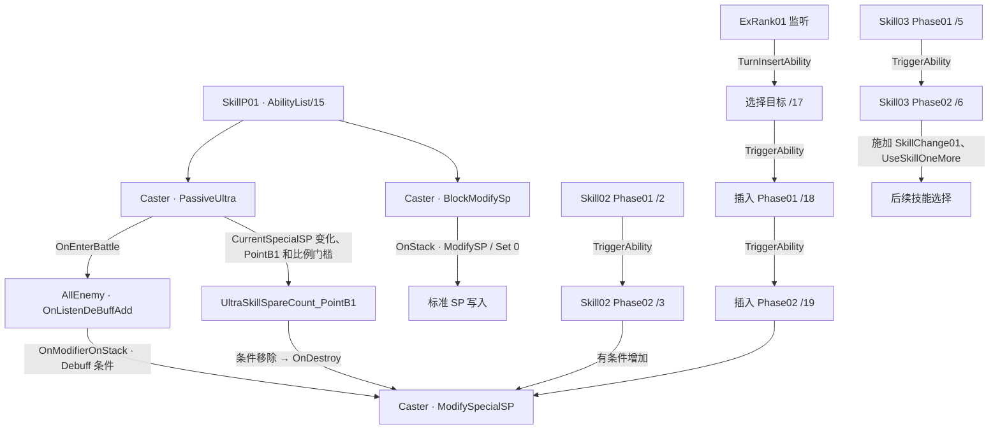

# 黄泉的负面状态监听、特殊 SP 与溢出回补

## 入口、目标与参数

主数据 `ExcelOutput/AvatarConfig.json#/51` 以 AvatarID 1308 指到 `Config/ConfigCharacter/Avatar/Avatar_Acheron_00_Config.json`。角色表的 `/SkillList/1`、`/SkillList/2`、`/SkillList/7` 分别绑定战技 Skill02（`EnemySelect` 与 `TargetAdjoinEntity`）、终结技 Skill03（`AllEnemy`）和天赋 SkillP01（`Caster`）。Ability 节点下文简写为 A，对应 `Config/ConfigAbility/Avatar/Avatar_Acheron_00_Ability.json`。主数据、技能触发键和同文件 Ability 名称共同支持这些 **Derived** 连边。

| 参数入口 | 声明及后续输入 |
| --- | --- |
| `ExcelOutput/AvatarSkillConfig.json#/2546`，SkillID 130802，Level 1 | `ParamList/2/Value=1` 由角色 `/DynamicValues/Floats/1525852618/ReadInfo` 的 Skill02、Index 2 绑定。A 的 `/AbilityList/3/OnStart/1/SuccessTaskList/0` 使用该哈希作 `ModifySpecialSP.FixedAddValue` |
| `ExcelOutput/AvatarSkillConfig.json#/2561`，SkillID 130803，Level 1 | Skill03 的 `SPNeed.Value=9`，另有 `ParamList/3/Value=9`。两个字段分别可见，费用的具体存储和结算点未知 |
| `ExcelOutput/AvatarSkillConfig.json#/2576`，SkillID 130804，Level 1 | `ParamList/0/Value=9`。角色 `/DynamicValues/Floats/1483210409/ReadInfo` 以 SkillP01、Index 0 连接敌方监听器中的 `MDF_Passive_Count` 上界比较 |
| `ExcelOutput/AvatarSkillTreeConfig.json#/2887`，PointID 1308101 | PointB1 的 `ParamList/1/Value=3` 由角色 `/DynamicValues/Floats/-590721991/ReadInfo` 指定。同一哈希直接出现在备用状态施加任务的 `MaxLayer` 与 `DynamicValues.MDF_PropertyValue`，配置上限输入均为 3 |
| `ExcelOutput/AvatarExRankConfig.json#/2`，角色 ID 1308 | 额外阶位参数 `NNACKOBKFGE/1/Value=1` 与角色的 ExRank01、Index 1（哈希 21888035）连到 A 的 `/AbilityList/19/OnStart/10/FixedAddValue`。详见 [绑定实测](../05-context-expression/binding-results.tsv) |

## Ability 和 Modifier 的配置图



**Observed**。A 的 `/AbilityList/15/OnStart/3` 添加 Caster 自身的局部 PassiveUltra，`/AbilityList/15/OnStart/5` 添加 BlockModifySp。后者 `/GlobalModifiers/MAvatar_Acheron_00_BlockModifySp/_CallbackList/0/CallbackConfig/1` 以 `ModifySP` 写 0，带 `IgnoreBlock=true`。前者在 `/AbilityList/15/Modifiers/MAvatar_Acheron_00_PassiveUltra/_CallbackList/7` 选择 `OnEnterBattle`，Priority 为 -80，向敌方添加 Debuff 监听器和空标记状态。目标是敌方，而后续特殊 SP 写入定向 `Caster`，形成一次持有者与收益接收者不同的配置链。

A 的 `/GlobalModifiers/MAvatar_Acheron_00_OnListenDeBuffAdd/_CallbackList/0` 观察 `OnModifierOnStack`，要求回调状态分类为 Debuff、Caster 无 Skill03_Special、`MDF_SkillUseFlag=1` 且未检测到 `MAvatar_Acheron_00_RuondDeBuffCD`。内层 `MDF_Passive_Count` 判断的成功分支由 `/CallbackConfig/0/SuccessTaskList/0/SuccessTaskList/0` 对 Caster 配置固定 +1，邻接任务写入 `MDF_SkillUseDubuff`、挂冷却 Modifier、引用能量条模板并读持有者状态数。其失败侧还有 PointB1 谓词和独立 +1。以下是节点的局部摘录。

```json
{
  "$type": "RPG.GameCore.ModifySpecialSP",
  "TargetType": {"$type": "RPG.GameCore.TargetAlias", "Alias": "Caster"},
  "FixedAddValue": {"IsDynamic": false, "FixedValue": {"Value": 1}},
  "IgnoreBlock": true
}
```

**Derived**。PassiveUltra 的 `/AbilityList/15/Modifiers/MAvatar_Acheron_00_PassiveUltra/OnAbilityPropertyChange/0` 监听 `CurrentSpecialSP`，对应的 `/Ranges/0/TriggerClampedChange` 为 true。其 `/Ranges/0/OnChange/0` 连接同定义 `/TaskListTemplate/0` 的检查模板。`/Ranges/0/OnChange/1` 在 PointB1、特殊 SP 比率达到 1 和 `ClampedAdd>0` 的嵌套条件下，对 Caster 施加 PointB1 的 SpareCount Modifier，传入 `MaxLayer`、`LayerAddWhenStack` 与具名动态值。层增量输入的哈希 -1993698044 与上游刚写入的 `Acheron_PointB1_ClampedAdd` 符合已验证的哈希候选。目标定义 `/GlobalModifiers/MAvatar_Acheron_00_UltraSkillSpareCount_PointB1/_CallbackList/1` 在 `OnStack` 以 `ValueType=Layer` 读层数，`/_CallbackList/0` 在 `OnDestroy` 以动态表达式配置 `ModifySpecialSP`。基础 SpareCount 的 `/GlobalModifiers/MAvatar_Acheron_00_UltraSkillSpareCount/_CallbackList/2` 则通过 `CheckParamFlagCallBack` 检查结算标记、持有者、Ultra 类型和比例小于 1，再请求 `RemoveSelfModifier`。基础和 PointB1 均有同类回补结构，参数及门槛仍按定义区分。

**Derived**。额外阶位路径给出特殊 SP 的独立写入点。`/GlobalModifiers/MAvatar_Acheron_00_ExRank01_Listener/_CallbackList/1` 选择 `OnAfterBeingAttacked`，其中 `/CallbackConfig/0/SuccessTaskList/1/SuccessTaskList/0/SuccessTaskList/0` 请求插入 SelectTarget，对 Caster 附持有者未用请求计数预检。A 的 `/AbilityList/17/OnStart/0/SuccessTaskList/0` 接 Phase01，`/AbilityList/18/OnStart/7` 再接 Phase02。后者含 `DamageByAttackProperty` 与 `ModifySpecialSP`，伤害和资源是不同任务。主终结技 `/AbilityList/5/OnStart/8` 具名接 Phase02，`/AbilityList/6/OnStart/5` 添加 SkillChange01，`/AbilityList/6/OnStart/11` 出现 `UseSkillOneMore`。

## 偏序、解释和缺口

- **Observed / Derived**。回调匹配、外层门槛和内层谓词各自约束后继任务。备用状态的写入、读层和销毁回补分别见于施加、OnStack 和 OnDestroy 三个入口，不能排成全局提交序列。
- **Inferred**。标准条被单独写零，战技和敌方监听复用特殊 SP 写入。多余的变化可由状态层留存，再通过显式移除回补。冷却标志对重复加点有约束迹象。事件是否每次施加触发、每回合与每行动的去重边界、同时到达的事件如何合并仍为 **Unknown**。
- 本案主体 Ability 与 Modifier 字面边已在文件内定位。Skill03 后续 `UseSkillOneMore` 节点没有写明目标技能索引，所用控制映射、资源提交时点、`ClampedAdd` 的具体采样时刻及外部 UI 模板效果仍留作 **Unknown**。
- 该案例支持 Modifier 充当跨实体监听器和资源暂存载体，也表明特殊资源接口与由状态表达的溢出策略可同时出现。与 [白厄](08-phainon.md) 的私有变量溢出对照可检验这一点。

[Ability](../01-entity-ability/report.md) · [原子操作](../02-atomic-operations/report.md) · [Modifier](../03-modifier/report.md) · [事件](../04-callback-trigger/report.md) · [上下文](../05-context-expression/report.md) · [资源与调度](../06-resource-scheduling/report.md)
