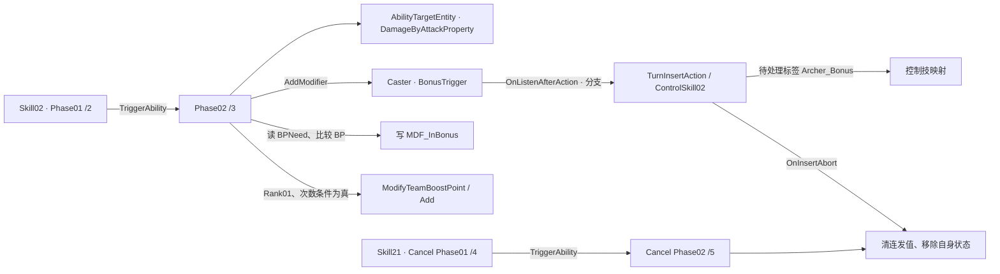
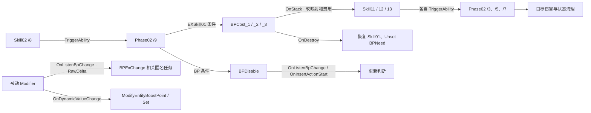

# Archer 的连发与丹恒·饮月的分阶支付

本案比较两套具有多阶段费用的配置。Archer 以一次战技的效果 Ability 和回调请求后续行动。丹恒·饮月先修改控制映射和费用属性，再由独立的强化普攻入口编辑伤害与清理状态。

## Archer · 队伍 BP 门槛、连发请求和返还

`ExcelOutput/AvatarConfigLD.json#/1` 的 AvatarID 1015 指向 `Config/ConfigCharacter/Avatar/Avatar_Archer_00_Config.json`（以下为 AC），且 SkillList 含 101502。 `ExcelOutput/AvatarSkillConfigLD.json#/76` 的 Level 1 行将该 ID 绑定到 Skill02，`BPNeed.Value=2`，参数原列表为 1.8、0.6、2、1、5。AC 的 `/SkillList/1` 将 `EnemySelect` 和 Phase01 入口并列。 `Config/ConfigAbility/Avatar/Avatar_Archer_00_Ability.json`（以下为 AA）的 `/AbilityList/2/OnStart/7` 具名触发 `/AbilityList/3` 的 Phase02。以上为 **Derived**。



**Observed**。AA 的 `/AbilityList/3/OnStart/1` 向 Caster 添加 `MAvatar_Archer_00_BonusTrigger`，`/OnStart/8` 以 `DamageByAttackProperty` 打向 `AbilityTargetEntity`。伤害表达式第一输入 -1847083384 由 AC 的 `/DynamicValues/Floats/-1847083384/ReadInfo` 连接 Skill02 参数 0 的 1.8。第二输入 -892802453 没有同口径的外部主数据读取声明，因此此处只确认第一输入。AA 的 `/OnStart/13` 用 `SetDynamicValueBySkillProperty` 读 `Skill02.BPNeed` 到 `MDF_BPNeed`。紧邻的 `/OnStart/14` 同时检查 BP、次数与 Windfury 相关状态，并在不同分支写 `MDF_InBonus`。BP 谓词输入哈希 494116178 在当前 Ability 声明的 `ReadInfo.Type=None`。`MDF_BPNeed` 用 [独立验证的哈希候选](../05-context-expression/hash-probe.md) 恰得到 494116178，构成读取当前技能费用的 **Inferred** 闭环。静态主表只给出基础费用 2，实际比较值可随技能属性变化。

**Observed**。AA 的 `/GlobalModifiers/MAvatar_Archer_00_BonusTrigger/_CallbackList/1` 选择 `OnListenAfterAction`。其 `/CallbackConfig/0` 查未用终结技和未用插入 Ability 的条件。`/CallbackConfig/1/SuccessTaskList/1/SuccessTaskList/0` 向 ModifierOwnerEntity 请求以下行动。失败分支的 `/CallbackConfig/1/FailedTaskList/0/Predicate/PredicateList/1/PredicateList` 读取「下一未用插入行动」并按持有者、Normal 与 Archer_Bonus、ActionTag_Windfury 标签判断。

```json
{
  "$type": "RPG.GameCore.TurnInsertAction",
  "TargetType": {"$type": "RPG.GameCore.TargetAlias", "Alias": "ModifierOwnerEntity"},
  "SkillType": "ControlSkill02",
  "CanInsertUltraSkill": true,
  "CustomTags": [{"Value": "Archer_Bonus"}],
  "FollowSameTagNormalAction": true
}
```

**Derived**。`ExcelOutput/AvatarConfigLD.json#/1/RankIDList/0` 为 101501，对应 `ExcelOutput/AvatarRankConfigLD.json#/6` 的 Rank01、Trigger Hash 2089636447 与 `Param=[3,2]`。AC 的 `/DynamicValues/Floats/952868987/ReadInfo` 和 `/DynamicValues/Floats/1424168145/ReadInfo` 分别声明 Rank01 的 Index 0、1。结合 AA 的 `/AbilityList/3/OnStart/10`，可复原在该阶位条件为真且 `MDF_Skill02UseCount=3` 的分支向队伍 BP 提交 Add 2。把此节点解释成连发的有条件返还是 **Inferred**，扣费与返还的实际提交时点为 **Unknown**。同一批次的共享星魂哈希不参与角色 ID 联接。

AA 的插入请求 `OnInsertAbort` 内写 `MDF_InBonus=0` 和 `RemoveSelfModifier`。AC 的另一入口 `/SkillList/2` 是 Skill21，指向 AA `/AbilityList/4`，其 `/OnStart/3` 指向取消 Phase02 `/AbilityList/5`，后者指名移除 BonusTrigger、重置标志并出现 `SkillPerformFinish`。取消节点未显式提交返还，不能由此推出运行时所有取消结果。

## 丹恒·饮月 · 可切换入口、费用覆写和实体储备

`ExcelOutput/AvatarConfig.json#/33` 的 AvatarID 1213 指向 `Config/ConfigCharacter/Avatar/Avatar_DanHengIL_00_Config.json`（以下为 DC）。该角色的 `/SkillList/1` 绑定 Skill02 提升入口，`/SkillList/3`、`/SkillList/4`、`/SkillList/5` 则分别绑定 Skill11、12、13 的独立 Ability。 `ExcelOutput/AvatarSkillConfig.json#/1333`、`ExcelOutput/AvatarSkillConfig.json#/1342`、`ExcelOutput/AvatarSkillConfig.json#/1351` 依次给出三档的 `BPNeed=1/2/3` 和 `AttackType=Normal`。相对地，角色 Skill02 对应 `ExcelOutput/AvatarSkillConfig.json#/1360` 的 `BPNeed=-1` 与 `AttackType=BPSkill`。因此攻击类别不足以单独判断费用。



**Derived**。 `Config/ConfigAbility/Avatar/Avatar_DanHengIL_00_Ability.json`（以下为 DA）的 `/AbilityList/8/OnStart/1` 触发 `/AbilityList/9` 的 Phase02。后者 `/OnStart/1` 以 `EXSkill01` 的 1、2、3 分层条件挂对应的 BPCost Modifier。 `/AbilityList/9/Modifiers/MAvatar_DanHengIL_00_BPCost_1/_CallbackList/1` 在 OnStack 通过 `SetControlSkillMapping` 指向 Skill11 并通过 `ModifySkillPropertyByName` 固定 `BPNeed=1`，同定义回调 0 在 OnDestroy 恢复 Skill01 并写 `Unset`。同一位置的 `BPCost_2`、`BPCost_3` 分别指向 Skill12、Skill13，覆写费用 2、3。各自 Phase01 /2、/4、/6 明文指向 Phase02 /3、/5、/7。以 DA 的 `/AbilityList/3/OnStart/2` 为例，`DamageByAttackProperty` 打向 `AbilityTargetEntity`，DC 的 `/DynamicValues/Floats/-1999440872/ReadInfo` 提供 Skill11 Index 0，与 Excel 首级 1.3 同值联接。观察到的 `HitSplitRatio=0.33` 是该段配置数据，伤害计算细节未知。

**Observed**。DA 的 `/AbilityList/9/OnStart/3` 用 ByCompareBP 的分支控制 `Avatar_DanHengIL_00_BPDisable`。该定义的 `/GlobalModifiers/Avatar_DanHengIL_00_BPDisable/_CallbackList/0` 经 OnStack 绑定 `AttachSkillTypeDisable(ControlSkill02)`，随后两个回调分别监听 `OnListenBpChange`、`OnInsertActionStart`。 DA 的 `/AbilityList/15/OnStart/2` 将局部 PassiveModifier 与角色关联。其 `/Modifiers/MAvatar_DanHengIL_PassiveModifier/_CallbackList/3` 读取 BP 事件的 `RawDelta`，在 ParamEntity 匹配 Caster 且变动值小于 0 的分支使用带 `BPExChange` 键的匿名类型 `LAJIKDENEOO`。同定义 `/OnDynamicValueChange/1/Ranges/0/OnChange/0` 向 ModifierOwnerEntity 使用 `ModifyEntityBoostPoint(Set)`，其他相邻任务处理显示和状态。**Inferred**，实体储备与队伍资源协作表达替代支付。内部扣减次序、事件 RawDelta 对截断的关系、匿名任务的运行时实现均为 **Unknown**。

## 对照和未解析

- Archer 的 BP 检查、可等待请求、计数和带标签的下一请求形成可回溯的连发约束。饮月的控制映射、覆写和恢复为不同强化入口划出费用边界。两例的显式有序关系仅包括具名调用和条件选中的后继，不据数组下标推断扣费、回调、动作入列的总顺序。
- Archer 请求携带 `ControlSkill02`。当时生效的入口和再入队算法待验证。饮月 `LAJIKDENEOO` 的精确语义未解析，多个修改叠加的优先规则未知。已定位的静态状态名与 TriggerAbility 边可以独立核对。
- 对照支持行动请求、费用属性、入口可用性、资源更新和攻击目标具有可区分的配置角色。不同角色可选择不同组合，完整支付事务仍为 **Unknown**。

[实体与 Ability](../01-entity-ability/report.md) · [操作参考](../02-atomic-operations/inventory.md) · [回调](../04-callback-trigger/report.md) · [参数](../05-context-expression/report.md) · [调度](../06-resource-scheduling/report.md)
