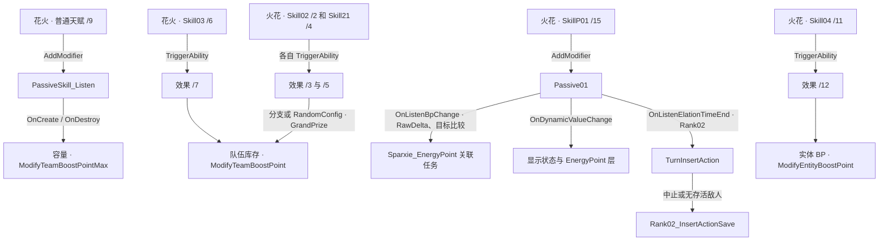

# 花火的队伍 BP 容量与火花的角色储备

两套配置都出现 BP 变化，同时能分别定位队伍容量、队伍库存、角色私有键、实体 BP 和显示状态。本文把标准能量记为 SP，把字段 `BPNeed` 等对应的战技点接口记为 BP。

## 花火 · 容量的生命周期与终结技回补

`ExcelOutput/AvatarConfig.json#/49` 的 AvatarID 1306 指向 `Config/ConfigCharacter/Avatar/Avatar_Sparkle_00_Config.json`（SC）。SC 的 `/SkillList/3` 将 SkillP01 映射给被动，目标 Caster。`/SkillList/2` 将 Skill03 映射给终结技，目标 AllTeamMember。下文的 SA 指 `Config/ConfigAbility/Avatar/Avatar_Sparkle_00_Ability.json`。

**Derived**。被动入口 SA `/AbilityList/9` 的 `/OnStart/0` 读取 MaxBP 到 `TeamBpMax`，`/OnStart/1` 向 Caster 附加局部 `Avatar_Sparkle_00_PassiveSkill_Listen`。该定义 `/AbilityList/9/Modifiers/Avatar_Sparkle_00_PassiveSkill_Listen/_CallbackList/0` 选择 OnCreate。Rank04 条件两侧均请求 `ModifyTeamBoostPointMax(Add)`。基础侧使用哈希 -1284285354，SC 的 `/DynamicValues/Floats/-1284285354/ReadInfo` 为 SkillP01、Index 2，连到 `ExcelOutput/AvatarSkillConfig.json#/3209/ParamList/2/Value` 的 2。Rank04 侧加入独立常量 1 与编译表达式。SC 对应角色的 `RankIDList/3` 为 130604，匹配 `ExcelOutput/AvatarRankConfig.json#/321` 的阶位与触发哈希 1686351920。相邻 `/_CallbackList/1` 选择 OnDestroy，同样发容量编辑，但使用不同表达式 `AQAOEQ==`。实际销毁后容量和库存的约束留作 **Unknown**。

**Derived**。SC Skill03 入口指 SA `/AbilityList/6`，其 `/OnStart/2` 触发 `/AbilityList/7` 的效果段。 `/AbilityList/7/OnStart/2` 的 Rank04 两侧均增加队伍当前 BP，并读 CurrentBP 到 `MDF_PassiveLayer02`。基础分支哈希 419301503 由 SC 的 `/DynamicValues/Floats/419301503/ReadInfo` 连接 Skill03 参数索引 1，`ExcelOutput/AvatarSkillConfig.json#/3194` 的 Level 1 行给出输入 4 与 SPNeed 110。该效果段还对 `AllTeamMember` 配置 PowerUp Modifier，见 SA `/AbilityList/7/OnStart/4`。容量任务和库存任务的参数各自独立。

```json
{
  "$type": "RPG.GameCore.ModifyTeamBoostPoint",
  "ModifyFunction": "Add",
  "ModifyValue": {
    "IsDynamic": true,
    "PostfixExpr": {"OpCodes": "AQAR", "FixedValues": [], "DynamicHashes": [419301503]}
  }
}
```

摘自 SA `/AbilityList/7/OnStart/2/FailedTaskList/0`。同文件未在该分支声明溢出时的存储目标，因此基础技能对应的写入意图可以确认，输出库存及截断规则为 **Unknown**。

## 火花 · 读事件变动、私有键与实体 BP

`ExcelOutput/AvatarConfig.json#/74` 的 AvatarID 1501 指向 `Config/ConfigCharacter/Avatar/Avatar_Sparxie_00_Config.json`（XC），SPNeed 为 160。XC 的 `/SkillList/1`、`/SkillList/4` 使用敌方选定和相邻副目标，分别接 Skill02 与 Skill21。 `ExcelOutput/AvatarSkillConfig.json#/5470` 和 `ExcelOutput/AvatarSkillConfig.json#/5485` 两条 Level 1 行对应技能 ID 150102、150109，基础 BPNeed 皆为 1。下文的 XA 指 `Config/ConfigAbility/Avatar/Avatar_Sparxie_00_Ability.json`。



**Observed**。XA `/AbilityList/15/OnStart/0` 施加 `MAvatar_Sparxie_00_Passive01`。其 `/GlobalModifiers/MAvatar_Sparxie_00_Passive01/_CallbackList/0` 选择 `OnListenBpChange`。它把 `RawDelta` 绑定到 `_BPChange`，且只在 ParamEntity 与 Caster 相合、`_BPChange<0` 时命中 `LAJIKDENEOO` 节点。该节点携带 Caster、`Sparxie_EnergyPoint` 及输入哈希 44315955，结构与饮月处理 `BPExChange` 的匿名节点同形。 `/GlobalModifiers/MAvatar_Sparxie_00_Passive01/OnDynamicValueChange/0` 则以哈希 1469843529 和 `ContextCaster` 表达变量监听，其中比较明文键、切换能量条状态、写变化量及堆叠 `MAvatar_Sparxie_00_EnergyPoint`。后者 OnStack 时按层数小于等于零决定是否移除自身，见 XA `/GlobalModifiers/MAvatar_Sparxie_00_EnergyPoint/_CallbackList/0`。

**Derived**。XA 的 `/AbilityList/2/OnStart/7` 与 `/AbilityList/4/OnStart/1` 分别请求 Skill02 和 Skill21 的效果段 `/AbilityList/3` 与 `/AbilityList/5`。前者 `/OnStart/14` 明文读取 Skill21.BPNeed 到 `_BPNeed`。两段可在次数和概率条件下直接引用 GrandPrize 模板，也能在失败侧的 `RandomConfig` 中选择 GrandPrize 或 MinorPrize。以 XA `/AbilityList/3/OnStart/7` 与 `/AbilityList/5/OnStart/0` 为对照。GrandPrize 定义在 XA `/GlobalTemplates/3`，`/TaskList/3` 用 `ModifyTeamBoostPoint(Add)`。哈希 -851278791 的角色读取声明为 Skill21、Index 0，主数据 `ExcelOutput/AvatarSkillConfig.json#/5485/ParamList/0/Value` 给出回补任务的输入 2。模板还写奖项计数 Modifier 与概率变量，随机分支具体采样规则为 **Unknown**。

**Observed / Derived**。XA `/AbilityList/11/OnStart/2` 明文接 Skill04 Phase02 `/AbilityList/12`，其 `/OnStart/4` 接欢愉范围效果模板，`/OnStart/5` 附角色私有键的匿名节点，`/OnStart/6` 才是实体 BP 的显式 `Set`，目标 Caster 且带 `IsSilence=true`。被动的 `/GlobalModifiers/MAvatar_Sparxie_00_Passive01/_CallbackList/2` 在 `OnListenElationTimeEnd` 选择 Rank02 与有敌人条件下的 `TurnInsertAction`，失败或插入中止挂 `MAvatar_Sparxie_00_Rank02_InsertActionSave`。RankID 150102 由角色的 `RankIDList/1` 对应 `ExcelOutput/AvatarRankConfig.json#/481`，其 `Param/0/Value=2` 通过 XC `/DynamicValues/Floats/-1937183604/ReadInfo` 成为该回调内匿名节点的输入。备用状态的本地模板可在 XA `/GlobalModifiers/MAvatar_Sparxie_00_Rank02_InsertActionSave/TaskListTemplate/0` 定位，多个后续监听器引用它。

## 变更边界与未解

- 花火的稳定证据是容量与库存的两种编辑任务，火花的稳定证据是 BP 事件与私有变量、层数、实体 BP 及队伍回补之间的配置依赖。**Inferred**，后者可用来表达实体储备和替代支付。
- 条件分支和模板引用把先决条件及后继范围限定在配置层。库存溢出如何截断、实体与队伍如何分摊支付、匿名节点的运算、Rank02 的具体插入优先级以及提示实际显示时点均为 **Unknown**。已核对的关键本地符号均能定位，`TurnInsertAction` 该点没有显式 AbilityName，终端技能选择留待运行时证据。
- 饮月和火花对 `RawDelta` 的相似结构支持复用，花火的独立上限操作给出了另一条资源建模路径。参见 [饮月与 Archer](05-archer-danhengil.md)、[资源与调度](../06-resource-scheduling/report.md)、[变量及上下文](../05-context-expression/report.md)、[事件](../04-callback-trigger/report.md) 和 [操作表](../02-atomic-operations/inventory.md)。
