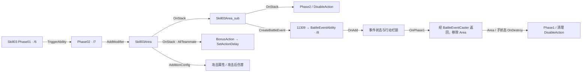

# 知更鸟（1309）：全队行动请求与独立倒计时实体

## 主数据与参数

**Observed**。 `ExcelOutput/AvatarConfig.json#/52` 给出 AvatarID 1309 与 JsonPath。 `Config/ConfigCharacter/Avatar/Avatar_Robin_00_Config.json#/SkillList/2` 的 `Name="Skill03"`，入口是 `Avatar_Robin_00_Skill03_Phase01`，目标为 Caster，另有准备 Ability。`ExcelOutput/AvatarSkillConfig.json#/2980` 的技能 ID 130903 一级参数为 0.152、90、50、0.72、1、1.5。角色 `DynamicValues.Floats` 的 1521926375 明确取 Skill03 索引 1，1324426262 取 Skill03 索引 3。

**Derived**。后续相对指针均位于 `Config/ConfigAbility/Avatar/Avatar_Robin_00_Ability.json`。Phase01 的 `/AbilityList/6/OnStart/5` 用 `TriggerAbility` 请求同文件 /AbilityList/7，后者 `/OnStart/1` 对 Caster 装上全局状态 `MAvatar_Robin_00_Skill03Area`。独立镜头请求可由 `/AbilityList/6/OnStart/4` 查到。



## 并列的队友、状态与表现任务

**Observed**。Area 的 `_CallbackList/3` 是 OnStack。它对 Caster 配置 `SetEntityActionState`、添加子状态，并在 `/CallbackConfig/2` 向 `AllTeammate` 附加 `MAvatar_Robin_00_Skill03_BonusAction`。该成员状态的 OnStack 对 `ModifierOwnerEntity` 配置 `SetActionDelay(0)`，还有 `RemoveSelfModifier`。因此队友是通过状态持有者各自获得配置任务。关键定位为 `Config/ConfigAbility/Avatar/Avatar_Robin_00_Ability.json#/GlobalModifiers/MAvatar_Robin_00_Skill03_BonusAction/_CallbackList/0`。展示在行动栏上是否表现为相邻行动以及每名队友的先后为 **Unknown**。

**Derived**。Area 的 `AdditionConfig.SubModifierList` 另有具名节点分发，`/SubModifierList/1` 与 `/SubModifierList/2` 都指 `AllTeamMemberWithUnselectable`，并标识 `IsHaloStatus=true`。第一节点对应 `MAvatar_Robin_00_Skill03_AtkUp` 的 OnStack，以 `StackProperty(AttackConvert)` 写向持有者。第二节点给 `MAvatar_Robin_00_Skill03_PursuedDmg` 传 `Skill03_DmgRatio`，哈希 1324426262 由一级技能提供 0.72。它在 OnAfterAttack 里按 `AttackTargetList` 做带随机与 MaxNumber=1 的 Retarget；其 `/CallbackConfig/1/TaskList/1` 用 `DamageByAttackProperty` 指向 ParamEntity，嵌套数据含 `AttackType="Pursued"`。这条攻击后任务在配置中直接是伤害原语。它与队友状态中的 `SetActionDelay` 分别使用不同接口。

## 独立事件实体及返回路径

**Observed**。子状态 `MAvatar_Robin_00_Skill03Area_sub` 的 `_CallbackList/1` 为 OnStack。它创建 EventID 11309，设置出现阶段，向 Caster 施加纯旗标状态 `{"BehaviorFlagList":["DisableAction"]}`。截取 `Config/ConfigAbility/Avatar/Avatar_Robin_00_Ability.json#/GlobalModifiers/MAvatar_Robin_00_Skill03Area_sub/_CallbackList/1/CallbackConfig/0`：

```json
{
  "$type":"RPG.GameCore.CreateBattleEvent",
  "EventID":{"IsDynamic":false,"FixedValue":{"Value":11309}},
  "DynamicValues":{"BattleEvent_Geji_00_BaseSpeed":{"IsDynamic":true,"PostfixExpr":{"OpCodes":"AQAR","FixedValues":[],"DynamicHashes":[1521926375]}}},
  "Team":"TeamLight"
}
```

**Derived**。 `ExcelOutput/BattleEventConfig.json#/46` 匹配 EventID，声明 TeamLight、AssistEvent 和 `AbilityList[0]="BattleEventAbility_Robin_00_Skill03"`。Ability 定义是知更鸟文件的 /AbilityList/8。它在 OnAdd 给事件实体挂两个状态，并在 `/OnAdd/2` 给 Caster 配 `LockActionDelayChange`，白名单主体为 Caster，理由为 `Mask_TurnBasedAdvance`。局部 `MAvatar_Robin_00_PassiveSkill01_BattleEvent_BaseSpeed` 在 OnStack 中对 Caster 写 `BaseSpeed`，表达式读 351043498。该整数与名称 `BattleEvent_Geji_00_BaseSpeed` 的静态哈希候选相合；创造任务的输入值为 90。以一次注入建立事件速度是 **Inferred**，事件行动值换算和状态再应用规则仍未知。

**Observed**。事件状态的 `OnPhase1` 分别以 `BattleEventCaster` 和 `Caster` 标记任务目标。 `/CallbackConfig/1`、`/CallbackConfig/2` 对 BattleEventCaster 写行动状态、置延迟为 0；`/CallbackConfig/10` 指名移除其 Area；`/CallbackConfig/12` 对 Caster 有 `ForceKill`，并带两个静默旗标。证据体位于 `Config/ConfigAbility/Avatar/Avatar_Robin_00_Ability.json#/GlobalModifiers/MAvatar_Robin_00_PassiveSkill01_BattleEvent/_CallbackList/0`。返回时 Area 的 OnDestroy 配置对子状态的移除，子状态 OnDestroy 有回到 Phase1、复位动画并移除 DisableAction 的独立任务。Area 另含 OnBeingLimbo 与 OnBeforeDying 的清理入口。

## 约束与未解

**Derived**。配置中存在双实体间明确的返回路由，公共目标字典的 `BattleEventCaster` 对应 `TargetFetchBattleEventCaster`。OnAdd 的事件处理、OnPhase1 的返回路径和 OnDestroy 中的状态清理之间有可核对的引用依赖。子状态设置阶段与行为旗标，补充了 Modifier 可表达行动限制的例证。**Unknown** 包括事件实体实际入行动栏的时点、与其他事件或插入请求的相对顺序、动画与 OnPhase1 的时间换算、死亡路径与自然结束的重入和同步。主要 Ability、状态和事件 ID 均有具名静态证据；镜头、非同帧派发与行动栏内部机制不在已解范围。

[状态生命周期](../03-modifier/report.md) · [事件路由](../04-callback-trigger/report.md) · [目标作用域](../05-context-expression/report.md) · [行动与 BattleEvent](../06-resource-scheduling/report.md)
