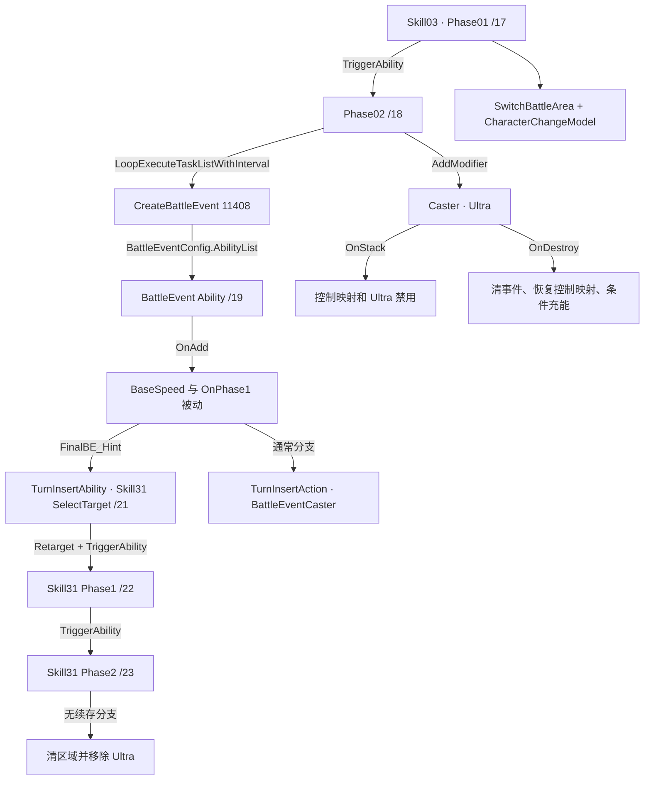

# 白厄的变身状态、特殊 SP 与 BattleEvent 倒计时

本案沿角色入口、变身区和模型、控制技重映射、战斗事件角色及回归清理，追踪配置如何同时编排实体状态和行动。溢出路径另和黄泉的状态层实现对照。

## 入口和参数

**Observed / Derived**。`ExcelOutput/AvatarConfig.json#/67` 为 AvatarID 1408，指向 `Config/ConfigCharacter/Avatar/Avatar_Phainon_00_Config.json`（以下为 PC）。 `ExcelOutput/AvatarSkillConfig.json#/4221` 的 SkillID 140803、Level 1 行具有 `SkillTriggerKey=Skill03`、`SPNeed.Value=12`、`ParamList=[4.8,12,0.6,8]`。PC 的 `/SkillList/2` 将它接到 `Avatar_Phainon_00_Skill03_Phase01`，目标为 Caster，并以逆向谓词筛查队伍目标词法式中的 `SpecialBattleArea` 行为旗标。PC 的 `/SkillList/4/UsableConditions/0/UsableCondition` 则要求 Caster 拥有 `MAvatar_Phainon_00_Ultra` 才满足 Skill21 的条件。能力文件 PA 指 `Config/ConfigAbility/Avatar/Avatar_Phainon_00_Ability.json`。

| 参数 | 可定位的读写 |
| --- | --- |
| 变身事件批量参数 | PC `/DynamicValues/Floats/766439870/ReadInfo` 为 Skill03、Index 3。首级输入 8 同时被 PA `/AbilityList/18/OnStart/4/MaxLoopCount` 与 `/AbilityList/18/OnStart/4/TaskList/0/DynamicValues/BE_Count` 读取。模板的具体执行次数和后继调度由运行时决定 |
| 变身 Modifier 属性入参 | PC `/DynamicValues/Floats/-911674397/ReadInfo`、`/DynamicValues/Floats/-1930233400/ReadInfo` 为 SkillP02、Index 3 与 4。 `ExcelOutput/AvatarSkillConfig.json#/4349` 的 SkillID 140805、Level 1 给出 0.4 与 1.35，在 PA `/AbilityList/18/OnStart/2/DynamicValues` 分别作为 `MDF_PropertyRatio`、`MDF_PropertyRatio2` |
| 倒计时实体 | `ExcelOutput/BattleEventConfig.json#/50` 的 ID 11408 为 `TeamLight`、`AssistEvent`，参数容器为空。它按 AbilityList 绑定 PA `/AbilityList/19` 的逻辑定义，另列摄像 Ability。速度不能从空列表读出。创建节点传递另外的动态 `BE_Speed` |

## 变身作用域和行动请求



**Derived**。 PA 的 `/AbilityList/17/OnStart/5` 具名触发 Phase02，与同段 `/OnStart/8` 的 `SwitchBattleArea(AreaName=PhainonBattleArea)`、`/OnStart/13` 的 `CharacterChangeModel` 分别描述能力调用、空间与表现变更。模型变更的 `OnSuccess` 中还调整角色配置。 Phase02 `/AbilityList/18/OnStart/2` 附 Ultra。其 `/GlobalModifiers/MAvatar_Phainon_00_Ultra` 声明 `SpecialBattleArea` 和 `SpecialActionState` 等旗标，`AdditionConfig.SubModifierList` 包含视觉管理、秩位条件属性与作用于敌方的 Halo 类弱点子状态。 `/_CallbackList/2` 的 OnStack 中，第 4–6 号任务绑定 Skill11、Skill22、Skill21，第 7 号 `AttachSkillTypeDisable` 对 ModifierOwnerEntity 明文列 `Types=["Ultra"]`。其 OnDestroy 另在 `/_CallbackList/0/CallbackConfig` 指定 ForceKill 目标 `Phainon_UltraBE`、移除特定状态、条件清理战场并恢复控制映射。

PA `/AbilityList/18/OnStart/4` 是带动态循环上限的 `LoopExecuteTaskListWithInterval`，`/TaskList/0` 具体创建 ID 11408 的同队实体。`/AbilityList/18/OnStart/5` 以 `RedirectActionDelayChange` 从 Caster 指向 `Phainon_UltraBE.SortByActionOrder.Select1`。PA `/GlobalTargetAlias/Phainon_UltraBE` 先选 `BattleEventEntityList` 再按是否带其 BaseSpeed Modifier 过滤，因此可以区分重定向来源、候选事件与事件施法者。事件自身在 PA `/AbilityList/19/OnAdd` 附被动和 BaseSpeed Modifier，在 `/OnAdd/2` 配置归一化行动延迟，`/OnAdd/4` 按 `BE_Index` 的条件选择 FinalBE_Hint 或 NormalBE_Hint。

**Observed**。事件回调位于 PA `/AbilityList/19/Modifiers/MAvatar_Phainon_00_Skill03_BattleEvent_Passive/_CallbackList/1`。OnPhase1 若满足 FinalBE_Hint 条件，向 `BattleEventCaster` 插入 Skill31_SelectTarget，目标 AllEnemy，含 `AbilityOwnerInsertUnusedCount=1` 及检查 ParamEntity 上 Ultra 的 `ActivePredicate`。其失败侧含不同类型的行动请求，摘录如下。

```json
{
  "$type": "RPG.GameCore.TurnInsertAction",
  "TargetType": {"$type": "RPG.GameCore.TargetAlias", "Alias": "BattleEventCaster"},
  "PlayReadyCamera": true,
  "CanInsertUltraSkill": true,
  "CustomTags": [{"Value": "Phainon_BEInsertAction"}]
}
```

**Derived**。PA `/AbilityList/21/OnStart/0` 从 AllEnemy 筛有效存活者，配置 `ByRandom=true` 与 `MaxNumber=1`，子任务接 Skill31 Phase1。`/AbilityList/22/OnStart/6` 指向 Phase2，`/AbilityList/23/OnStart/6` 执行 `DamageByAttackProperty`。后者 `/OnStart/12` 的两侧分别处理续存与清理。可核对包含 `MStory_Main_Phainon_UltraNeverEnd` 或昔涟联动标志与 `ADF_BECount` 的谓词、失败侧的 `Phainon_00_ClearAvatarArea` 和 `RemoveModifier(Ultra)`。清理模板声明在 PA `/GlobalTemplates/2`，含对战斗区的切换。普通事件分支的 `TurnInsertAction` 没有具名技能，最终动作选择取决于控制映射和运行上下文。

## 特殊资源的转入、溢出和回补

**Observed**。PC `/SkillList/6` 对应 PA `/AbilityList/24`。其局部被动 `/AbilityList/24/Modifiers/MAvatar_Phainon_00_PassiveSkill01/_CallbackList/0/CallbackConfig/1` 把标准 SP 置 0。PA `/GlobalTemplates/1` 的 `Phainon_00_Passive_ChargeEnergyToGainSP` 用动态循环上限，单次循环比较 Caster 的特殊 SP 比例，低于 1 配置 `ModifySpecialSP` 固定 +1，否则向 `ContextCaster.CurOverflowSpecialSP` 固定 +1。角色二号行迹的入口可从 `ExcelOutput/AvatarSkillTreeConfig.json#/3662` 连接 PA `/AbilityList/28`。其 `/Modifiers/M_Phainon_00_SkillTree02_SubListener/_CallbackList/1` 列出 OnSPChange、队友及技能标志条件、参数读取和 `ByCompareSPChangeTag[{EnumIndex:6,Value:1}]`，成功时再调用充能模板。目标、标签、输入和后继具名关系可追溯。标签的全局含义仍待进一步验证。

**Derived**。PA `/AbilityList/24/Modifiers/MAvatar_Phainon_00_PassiveSkill01/OnDynamicValueChange/0` 监听 ContextCaster 的哈希 -133066886。其成功分支在 Caster 缺少 Ultra 且明文 `CurOverflowSpecialSP>0` 时，按 SPOverflow 是否存在，添加它或更新它的 `MDF_Count`。写入表达式也读取 -133066886。该数字与变量名的[哈希候选](../05-context-expression/hash-probe.md)一致，支持变量到 Modifier 参数的静态桥接。PA `/GlobalModifiers/MAvatar_Phainon_00_SPOverflow/_CallbackList/1` 在移除 Ultra 且特殊 SP 比例不足 1 时移除自身。`/_CallbackList/0` 的 OnDestroy 同时列重置溢出变量和带动态参数再调用充能模板。与 [黄泉](04-acheron.md) 对照，白厄用变量留存溢出并以 Modifier 的具名参数衔接回补，黄泉把溢出存入 Modifier 层。两种留存策略都复用特殊 SP 写入接口。

## 可证偏序与剩余问题

- 具名调用、模板归属、字段读写依赖、OnAdd 和 OnDestroy 的归属与互斥分支可复核。配置没有给出模型切换、批量事件全部创建完毕、回调注册与行动入队的总时序。
- **Inferred**。战场区与控制映射约束普通角色动作，带速度和行动值的 BattleEvent 向施法者分段申请行动或收尾 Ability。每一事件的实际间隔、速度两个表达式操作数的运行时来源、`SortByActionOrder` 的同值处理和费用消耗时点属于 **Unknown**。
- 主要 Ability 和模板字面边在角色、事件表及同一 Ability 资源内可解。普通分支的匿名终端动作、编译表达式完整求值、目标身份在事件过程中是否重绑定、本地剧情标志的外部注册生命周期、资源回补的跨事件精确时序继续保留 **Unknown**。
- 本案支持独立事件实体、技能入口、调度请求和修正状态各有可见表达，也说明 `SpecialBattleArea` 这类机制语汇仍可能由公共任务与专用标志共同承载。

[实体与 Ability](../01-entity-ability/report.md) · [Modifier](../03-modifier/report.md) · [事件](../04-callback-trigger/report.md) · [上下文](../05-context-expression/report.md) · [资源调度](../06-resource-scheduling/report.md)
