# 刻律德菈 · 授权状态与公共 Windfury 再施放

本案沿 1412 的战技收件人追踪到共享 Modifier 和插入行动，分别考察技能索引、施加者和目标列表。

## 入口、参数与配置图

**Derived**。 `ExcelOutput/AvatarConfig.json#/70` 的角色 1412 列出技能 141202 和角色配置路径。 `ExcelOutput/AvatarSkillConfig.json#/4524` 的技能 141202 等级 1 使用 `SkillTriggerKey="Skill02"`，`BPNeed.Value=1`，`ParamList=[0.36,1,8,6,0.08]`，此处用裸值简写各 `{"Value":…}` 对象。 `Config/ConfigCharacter/Avatar/Avatar_Cerydra_00_Config.json#/SkillList/1` 的 `EntryAbility` 与 `Config/ConfigAbility/Avatar/Avatar_Cerydra_00_Ability.json#/AbilityList/2/Name` 同名。角色 `DynamicValues/Floats/208472327/ReadInfo` 精确指定 `SkillParam`、`Skill02`、Index 3，因此 `/AbilityList/7/Modifiers/MAvatar_Cerydra_00_PassiveSkill/OnDynamicValueChange/0` 内 `DV_CurrentPoint` 的该哈希阈值绑定到等级 1 输入 6。

```mermaid
flowchart LR
    A["Skill02 → AbilityList/2"] -->|"分支中的 TriggerAbility"| B["Skill02_Others_Phase02 · /3"]
    B -->|"收件人条件 · AddModifier"| C["Skill02_Target"]
    C -->|"OnBeforeSkillUse · 局部键"| E["点数相关模板和观察器"]
    E -->|"TurnInsertAbility"| F["Skill02_InsertRank01 · /8"]
    B -->|"另一分支 · IncludeTaskListTemplate"| G["ReachPromotionRank01"]
    F -->|"IncludeTaskListTemplate"| G
    G -->|"AddModifier"| H["Skill02_Target_Lv2 与 MCommon_Windfury"]
    H -->|"OnAfterSkillUse · 满足门槛"| I["TurnInsertAction · ModifierOwnerEntity"]
```



**Derived**。Ability 指针以下均相对于刻律德菈 Ability 文件。 `/AbilityList/2/OnStart/1/SuccessTaskList/23` 用 `TriggerAbility` 对 `Caster` 请求 Phase02。Phase02 的 `/AbilityList/3/OnStart/3` 先按目标是否已有 `MAvatar_Cerydra_00_Skill02_Target` 分流，成功支对 `AbilityTargetEntity` 加同名状态并传 `DV_PointAdded_Get`。状态的 `AdditionConfig.SubModifierList` 显式区分写给 `Caster` 的 `Skill02_ListenSelf` 与写给 `ModifierOwnerEntity` 的其他子状态，部分另带行迹或星魂谓词。 `/GlobalModifiers/MAvatar_Cerydra_00_Skill02_Target/AdditionConfig/SubModifierList/0`。

**Observed**。在持有者的 `OnBeforeSkillUse`，对 `MCommon_Windfury` 的 `Remodifier.TaskList/0` 配置 `SetDynamicValueByCopying`，把该 Modifier 的 `Windfury_Flag` 读到 `MDF_Windfury_Flag`，`TargetContextScope="ContextModifier"`。同回调的另一个分支有谓词和模板调用。 `Config/ConfigAbility/Avatar/Avatar_Cerydra_00_Ability.json#/GlobalModifiers/MAvatar_Cerydra_00_Skill02_Target/_CallbackList/1`。

**Derived**。`DV_CurrentPoint` 的观察器成功支配置 `TurnInsertAbility`，请求同文件 `/AbilityList/8`，以 `Cerydra_00_PromoteTarget` 作为 `AbilityTarget`，预检具名插入待处理数，另查条件。插入能力的 `/AbilityList/8/OnStart/16` 和 Phase02 的 `/AbilityList/3/OnStart/3/FailedTaskList/0/SuccessTaskList/3` 都含同名 `IncludeTaskListTemplate`。 `/GlobalTemplates/0/TaskList` 中有删除 Lv1、加 Lv2、加公共 `MCommon_Windfury` 和设置延期标志。第三个操作以可定位别名指向持有基础状态者，并传：

```json
{"ModifierName":{"Value":"MCommon_Windfury"},"DynamicValues":{"_ReplaySkill":{"IsDynamic":false,"FixedValue":{"Value":1}}}}
```

## 再施放、条件偏序与残差

**Observed**。公共定义 `Config/ConfigGlobalModifier/GlobalModifier_Common_Specific.json#/ModifierMap/MCommon_Windfury/_CallbackList/5` 是 `OnAfterSkillUse`。其首条分支检查技能类型与重放模式、`_IsAimEnemySkill=1`、`_IsWindfurySkill=0`、`MDF_WindfuryCount>=1`。在 `/CallbackConfig/0/SuccessTaskList/3/SuccessTaskList/0/FailedTaskList` 子组内可见读取当前行动技能索引到 `_CurrnetSkillIndex` 的子支，以及角色 1501、1507 的特定技能索引覆盖。该子组第 3 项为 `TurnInsertAction`，给出动态 `SkillIndex`、`ModifierOwnerEntity`、`AutoCastTargetType="ModifierOwnerSkillTargetEntityList"`、优先级 `Windfury` 和 `ActionTag_Windfury`。同回调其他支路提供 `SkillTag` 或 `ControlSkill02`。

**Derived**。共享状态声明前置的 `OnBeforeSkillCost`、`OnBeforeSkillUse`，另有插入开始、插入完成和波次事件。上述请求的 `OnInsertAbort` 下可查到清旗标与 `RemoveSelfModifier` 条件支。刻律德菈 Lv2 的 `OnDestroy` 还以 `OnlyRemoveCasterAdded=true` 对持有者移除公共状态。局部可确认的顺序包括进入指定事件、通过各自谓词、发出插入请求，以及发生中止时进入清理支。 `Config/ConfigGlobalModifier/GlobalModifier_Common_Specific.json#/ModifierMap/MCommon_Windfury/_CallbackList/3` · `Config/ConfigGlobalModifier/GlobalModifier_Common_Specific.json#/ModifierMap/MCommon_Windfury/_CallbackList/7` · `Config/ConfigAbility/Avatar/Avatar_Cerydra_00_Ability.json#/GlobalModifiers/MAvatar_Cerydra_00_Skill02_Target_Lv2/_CallbackList/1/CallbackConfig/2`。

**Inferred**。此链支持保留或重选技能索引与目标后，以持有者身份再发行动请求。共享重放接口和角色局部授权、专用索引分支可以共存。**Unknown**。动态索引分支最终命中的 Ability 由受体当时的映射决定。配置未解决完整执行帧继承、目标失效、费用覆盖最终取值、嵌套派发或跨监听者排序。分支的明文 Modifier 和模板可定位，动态代入无法枚举为单一终点。 [Callback](../04-callback-trigger/report.md) · [目标与上下文](../05-context-expression/report.md) · [资源和行动](../06-resource-scheduling/report.md)

[静态校验脚本](verify_cross_entity.py) · [实跑日志](cross-entity-validation.log)
