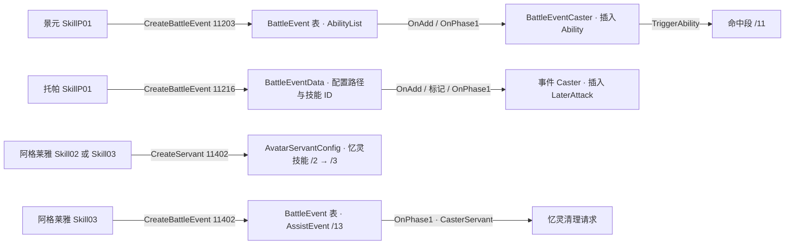

# 景元、托帕、阿格莱雅 · 召唤实体、归属与行动

本案比较共享 `CreateBattleEvent` 的景元与托帕，再以阿格莱雅的 `CreateServant` 对照。路径中的角色名为 dump 原文。

## 三条入口与 Ability 图

| 实体 | 明文入口和参数 |
| --- | --- |
| 景元 1204 | `ExcelOutput/AvatarConfig.json#/24` 列出 120404。其等级 1 行 `ExcelOutput/AvatarSkillConfig.json#/3098` 为 SkillP01，参数索引 0 值 60。 `Config/ConfigCharacter/Avatar/Avatar_JingYuan_00_Config.json#/SkillList/3` 的 `EntryAbility` 对应景元 Ability 文件 `/AbilityList/7`，角色 `DynamicValues/Floats/-280706620/ReadInfo` 把 60 联到创建请求内的 `BattleEvent_JingYuan_00_BaseSpeed` 具名实参。 |
| 托帕 1112 | `ExcelOutput/AvatarConfig.json#/20` 列出 111204。 `ExcelOutput/AvatarSkillConfig.json#/2004` 的等级 1 行为 SkillP01，参数索引 2 值 0.5。 `Config/ConfigCharacter/Avatar/Avatar_Topaz_00_Config.json#/SkillList/3` 指向托帕 Ability 文件 `/AbilityList/8`。角色 `DynamicValues/Floats/-1413852560/ReadInfo` 指定 SkillP01 Index 2，是后续行为延迟表达式的输入，表达式编码带额外字节。 |
| 阿格莱雅 1402 | `ExcelOutput/AvatarConfig.json#/61` 列出 140202、140208、140203，等级 1 行分别见 `ExcelOutput/AvatarSkillConfig.json#/3856`、`ExcelOutput/AvatarSkillConfig.json#/3918`、`ExcelOutput/AvatarSkillConfig.json#/3871`。角色配置 `Config/ConfigCharacter/Avatar/Avatar_Aglaea_00_Config.json#/SkillList/1` 指向 Skill02 Phase01。角色 `DynamicValues/Floats/-909740667/ReadInfo` 与索引 2 将 Skill11 值 1 联到 `CreateServant.DynamicValues.Skill11_DamagePercentage`，`DynamicValues/Floats/1121220047/ReadInfo` 与索引 3 将 Skill03 值 100 联到 BattleEvent 基础速度实参。 |



## 创建、标记与请求

**Derived · 景元**。 `Config/ConfigAbility/Avatar/Avatar_JingYuan_00_Ability.json#/AbilityList/7/OnStart/4` 固定 EventID 11203，带 `PropertyFromTarget=Caster`、TeamLight 和具名速度实参。 `ExcelOutput/BattleEventConfig.json#/42` 是同 ID 的 DummyCharacter，声明 TeamNeutral 和两个 Ability 名，可联到景元 Ability 的 `/AbilityList/9`、`/AbilityList/12`。 `/AbilityList/9/OnAdd/0` 给事件侧 `Caster` 加 `MAvatar_JingYuan_00_BattleEvent`。该 Modifier 的 `Config/ConfigAbility/Avatar/Avatar_JingYuan_00_Ability.json#/GlobalModifiers/MAvatar_JingYuan_00_BattleEvent/_CallbackList/0/CallbackConfig/0` 在 OnPhase1 请求 `Avatar_JingYuan_00_Passive_Insert`，执行别名为 `BattleEventCaster`、攻击目标 `AllDarkTeam`，并有 `STAT_CTRL`、`DisableAction` 中止标志。这是精简字段摘录：

```json
{"$type":"RPG.GameCore.TurnInsertAbility","TargetType":{"$type":"RPG.GameCore.TargetAlias","Alias":"BattleEventCaster"},"AbilityTarget":{"$type":"RPG.GameCore.TargetAlias","Alias":"AllDarkTeam"},"AbilityName":{"Value":"Avatar_JingYuan_00_Passive_Insert"}}
```

`/AbilityList/10/OnStart/7` 再调用 `/AbilityList/11` 的具名命中段，后者包括 `LoopExecuteTaskList` 及战斗表现/Modifier 清理。另一个局部标记有 `OnListenCharacterDie` 回调。 `Config/ConfigAbility/Avatar/Avatar_JingYuan_00_Ability.json#/AbilityList/9/Modifiers/MAvatar_JingYuan_00_BattleEvent_ForceKill/_CallbackList/0`。

**Derived · 托帕**。 `Config/ConfigAbility/Avatar/Avatar_Topaz_00_Ability.json#/AbilityList/8/OnStart/7` 固定 EventID 11216。 `ExcelOutput/BattleEventConfig.json#/44` 的 AbilityList 为空。另一个主表 `ExcelOutput/BattleEventData.json#/107` 实有 `Config` 路径，列出技能 1121604；技能主表 `ExcelOutput/BattleEventSkillConfig.json#/7` 为 SkillP01，含参数 1.1。 `Config/ConfigCharacter/Avatar/Avatar_Topaz_00_BE_Config.json#/SkillList/0` 指向 `Avatar_Topaz_00_BE_PassiveSkill`。它的定义在托帕 Ability `/AbilityList/10`，OnAdd 给 `Caster` 加 `Topaz_BETag`，其 OnCreate 中有 `AttachEntityUnselectable`。 `/GlobalTargetAlias/Topaz_BattleEventEntity` 从 `BattleEventEntityList` 筛同名标记。事件自身 `/AbilityList/10/Modifiers/Topaz_BETag/_CallbackList/1/CallbackConfig/2` 在 OnPhase1 搜寻带 `MAvatar_Topaz_BETargetTag` 的存活敌人，成功支把同类查询传给 `TurnInsertAbility`，请求本文件 `/AbilityList/15` 的 LaterAttack。托帕本体 `/AbilityList/8/Modifiers/Avatar_Topaz_00_Passive/_CallbackList/4` 则在 OnListenModifierAdd 条件下对 `Topaz_BattleEventEntity` 使用 `ModifyActionDelay`。这两个路径分别配置行动请求和行动延迟变化。

**Derived · 阿格莱雅**。 `Config/ConfigAbility/Avatar/Avatar_Aglaea_00_Ability.json#/AbilityList/2/OnStart/1` 指名 Phase02； `/AbilityList/3/OnStart/1/SuccessTaskList/0` 配置 `CreateServant(ServantID=11402)`。 `ExcelOutput/AvatarServantConfig.json#/0` 给出衣匠的独立角色路径、`SkillIDList`、速度和 HP 的继承参数。 `ExcelOutput/AvatarServantSkillConfig.json#/0` 的 1140201、Skill01 和等级 1 参数 0.55 联到 `Config/ConfigCharacter/Servant/Servant_AglaeaServant_00_Config.json#/SkillList/0`。该角色的 `DynamicValues/Floats/-1126825319/ReadInfo` 指定忆灵自身 Skill01 参数 0。 `Config/ConfigAbility/Servant/Servant_AglaeaServant_00_Ability.json#/AbilityList/2/OnStart/0` 传入已有 `AbilityTargetEntity` 到 Phase02，后者 `/AbilityList/3/OnStart/1` 为 `DamageByAttackProperty`，AttackType 为 Servant，读同一个伤害参数哈希。与此并行，阿格莱雅终结技 Phase02 `/AbilityList/12/OnStart/9` 创建同号 11402 的 BattleEvent； `ExcelOutput/BattleEventConfig.json#/48` 是 AssistEvent，挂 `/AbilityList/13`。该能力 `OnAdd` 布置同名 Modifier 并调用 `LockActionDelayChange`；Modifier 的 `/_CallbackList/0/CallbackConfig/1/TaskList/0` 在 OnPhase1 的局部分支向忆灵发清理请求，另一回调包含 BaseSpeed 设置。

## 偏序与结论

**Observed**。明确的局部顺序是事件能力的 OnAdd 负责安装列表中的状态，标记已存在才满足之后的查询；OnPhase1 请求还受具体谓词和中止标志约束。三类配置分别出现攻击归属 `BattleEventCaster`、事件 `Caster`、独立 Servant 技能与显式继承目标。**Inferred**。配置可表达独立行动对象与行动发起者的关系，两种创建指令读各自的 ID 域，阿格莱雅同号记录提供域隔离的直接对照。**Unknown**。TeamLight 与 TeamNeutral 的实际覆盖优先级、创建何时对后续查找可见、事件行动的速度公式、托帕扣减表达式的完整求值、两个实体同帧行动的顺序及继承属性最终值仍未知。托帕的主表空名单可由独立路径补齐，跨文件相机与原生表现调用的调度顺序仍保留残差。 [实体与 Ability](../01-entity-ability/report.md) · [目标及表达式](../05-context-expression/report.md) · [调度](../06-resource-scheduling/report.md)

[静态校验脚本](verify_cross_entity.py) · [实跑日志](cross-entity-validation.log)
