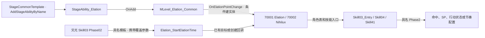

# 阿哈、欢愉时间与爻光 · 关卡能力和公共请求

本案描述公共关卡规则如何容纳 70001、70002 两个战斗事件变体，以及可玩角色如何通过同一配置界面启动阶段、传入资源参数并监听结束。

## 入口与参数绑定

**Observed**。`Config/Level/StageCommonTemplate.json#/OnStartSequece/1/TaskList/6` 用反转的 `ByCompareStageType(CurrentStageType="FateRin")` 包住 `AddStageAbilityByName`。成功支指名 `StageAbility_Elation`，唯一索引候选为 `Config/ConfigAbility/BattleEvent/StageAbility_Elation.json#/AbilityList/0`。其 OnAdd 给 Caster 安装 `MLevel_Elation_Common`，OnStart 预加载事件 ID 70001 与 70002。

**Derived**。事件主表 `ExcelOutput/BattleEventConfig.json#/408`、`ExcelOutput/BattleEventConfig.json#/496` 分别是 70001 和 70002，均声明 `EventSubType="Elation"` 和空 AbilityList。同 ID 对应的 `ExcelOutput/BattleEventData.json#/371`、`ExcelOutput/BattleEventData.json#/456` 则给出 Elation 与 Nihilux 的不同角色路径，两者共用技能 ID 7000101、7000102、7000103。以 70001 为例：

| 技能记录 | 角色配置与 Ability |
| --- | --- |
| `ExcelOutput/BattleEventSkillConfig.json#/165`，Skill04 | `Config/ConfigCharacter/BattleEvent/BattleEvent_Elation_Config.json#/SkillList/1` 的 Phase01 对应公共 Ability 的 `/AbilityList/2`。 `/OnStart/22` 请求 `/AbilityList/3`。 |
| `ExcelOutput/BattleEventSkillConfig.json#/166`，SkillP01 | 角色 `/SkillList/5` 对应公共 `/AbilityList/8`，其 `/OnStart/1` 安装 `MBattleEvent_Elation_Passive`。 |
| `ExcelOutput/BattleEventSkillConfig.json#/167`，Skill41 | 角色 `/SkillList/2` 对应公共 `/AbilityList/4`，其 `/OnStart/5` 请求 `/AbilityList/5`。角色 `DynamicValues/Floats` 把四个该技能参数联到循环内的选路、伤害和 SP 任务，详见下文。 |

配置图中的箭头表示静态关联或条件请求，事件时刻、速度和插入比较算法保持未知。



## 公共观察器、资源出口与结束

**Observed**。 `Config/ConfigAbility/BattleEvent/StageAbility_Elation.json#/GlobalModifiers/MLevel_Elation_Common/OnElationPointChange/0` 声明 0–9999 范围。第二个 OnChange 项要求 `ParamValue > 0`。内层按关卡实体是否带 `MAvatar_GlobalSkill_Nihilux_10_Main` 选择搜寻 70002 或 70001。搜寻失败时有如下配置，给出 70001 对照分支：

```json
{"$type":"RPG.GameCore.CreateBattleEvent","EventID":{"IsDynamic":false,"FixedValue":{"Value":70001}},"Team":"TeamNeutral","IsDynamicPreload":true,"AllowDuplicate":true}
```

**Derived**。事件侧 `Config/ConfigAbility/BattleEvent/StageAbility_Elation.json#/GlobalModifiers/MBattleEvent_Elation_Passive/OnElationPointChange/0` 根据 `Elation_CurrentPoint <= 0` 对事件装上 `MLevel_ElationBE_ActionStateFalse` 或移除它。该控制 Modifier 的 `OnStack` 有 `SetEntityActionState(ActionState=false)`，OnDestroy 中同键同目标而省去 ActionState 字段。被动的 OnPhase1 还配置独立的 `TurnInsertAction(SkillIndex=0)`，中止支安插 `MBattleEvent_Elation_InsertActionCheck`。公共 Skill03 Entry 在 `/AbilityList/1/OnStart/3` 以 `ElationTime_CanStartElationTime` 选择带 `StartElationTime` 优先级的 SkillIndex 1 请求或另支 SkillIndex 2 请求，并传覆盖资源与自定义字符串。角色表分别列出 Skill04、Skill41 的入口；这些数字的运行时映射可另外受规则影响。

**Observed / Derived**。 `Config/ConfigAbility/BattleEvent/StageAbility_Elation.json#/AbilityList/5/OnStart/1/TaskList/0` 的 `RandomConfig` 以 Skill41 Index 2 与 3 的哈希读入两个 0.5。两个 `Bounce_SelectTarget` 任务分别传 `AllLightTeam` 与 `AllDarkTeam`。前者用模板实参子任务对所选 `ParamEntity` 请求固定伤害值 1 及 `ModifySPNew.AddValue`；Index 4 绑定技能行 `/167/ParamList/4` 的 2。后者用 `FormulaType="ByElationDamage"`，欢愉伤害比例哈希来自 Index 1，输入 3。用到的角色声明为 `Config/ConfigCharacter/BattleEvent/BattleEvent_Elation_Config.json#/DynamicValues/Floats`。 `Config/ConfigGlobalTaskListTemplate/GlobalTaskListTemplate.json#/TaskListTemplate/30` 是该选择模板的名字候选。两个权重值、循环上限 10 和两类子任务是直接证据，最终抽样概率、次数及伤害结算是 Unknown。

**Observed**。公共事件被动 `/_CallbackList/7` 的 `OnListenElationTimeStart` 安装 `GlobalModifyInsertAbilityPriority` 的映射，含 `MonsterReviveSelf → DuringElationTime_MonsterReviveSelf` 与 `UseElationSkill → DuringElationTime_UseElationSkill`。 `/_CallbackList/8` 的 `OnListenElationTimeEnd` 则显式 `ResetToDefault=true` 并清理临时行动状态。 `Config/ConfigAbility/BattleEvent/StageAbility_Elation.json#/GlobalModifiers/MBattleEvent_Elation_Passive`。

## 可玩角色的接入与解释边界

**Derived**。 `ExcelOutput/AvatarConfig.json#/75` 的爻光 1502 列 150203； `ExcelOutput/AvatarSkillConfig.json#/5629` 的等级 1 Skill03 参数 Index 3 为 20，且角色 `Config/ConfigCharacter/Avatar/Avatar_YaoGuang_00_Config.json#/DynamicValues/Floats/-1393817439/ReadInfo` 对应同索引。 `Config/ConfigAbility/Avatar/Avatar_YaoGuang_00_Ability.json#/AbilityList/6/OnStart/4` 的星魂失败支把该值传为 `TryStartElationTime_OverrideElationPoint`，另传 `NoConsume=1` 与自定义标签。成功支另含一个表达式项，并加 `MAvatar_YaoGuang_00_BE_ModifyDam_ToBE`。 `Config/ConfigGlobalTaskListTemplate/GlobalTaskListTemplate.json#/TaskListTemplate/50` 接收这些参数，已有实体和创建回调两种分支都配置目标为 `ParamEntity` 的插入行动。爻光 Modifier 在 `OnListenElationTimeStart/End` 两回调以相同标签匹配 `ParamString`，分别设置 1/0 和自行清理。另有独立的 `ModifySPNew` 给 Caster 写入 AddRatio 1。控制入口、覆盖参数、标准能量操作和阶段监听可分别定位。

**Inferred**。关卡规则以阶段点数观察创建和启停事件，可玩角色传入本次阶段的参数及标识，随后相关监听者依据标识做局部处理。映射修改说明阶段内优先级具配置接口。可证偏序限于失败选择后创建、创建回调中的请求、显式谓词成功后的写入。**Unknown**。 `DIHCJLDIMNA`、`JDOLDFECMPL` 等不透明节点、NoConsume 的实际扣除算法、插入优先级全序，以及阶段事件与资源提交的同帧顺序均未解决。爻光的具名 `SkillAha` 定义本身有空 OnStart，仍须沿可查路径找实现片段。 `Config/ConfigAbility/Avatar/Avatar_YaoGuang_00_Ability.json#/AbilityList/9`。

70002 的角色配置有另一套 `BattleEventAbility_Nihilux_*` 入口；专用玩法还有独立 `Activity_ElationBattle_LevelAbility` 定义，两者都应按所在路径研究。 `Config/ConfigCharacter/BattleEvent/BattleEvent_Nihilux_Config.json#/SkillList/0` · `Config/ConfigAbility/ElationBattle/Avatar_ElationBattle_Common_Ability.json#/AbilityList/0` · [资源和调度](../06-resource-scheduling/report.md) · [事件](../04-callback-trigger/report.md)

[静态校验脚本](verify_cross_entity.py) · [实跑日志](cross-entity-validation.log)
