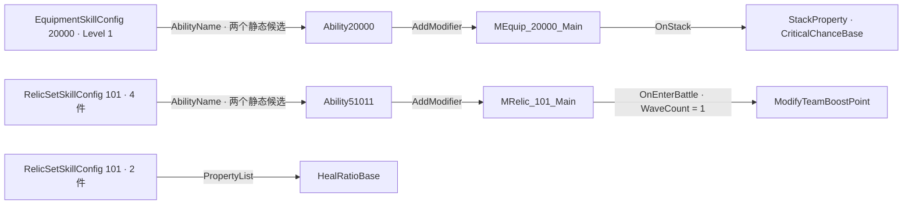

# 光锥 20000 与遗器套装 101 的效果注入

本案比较光锥等级参数、遗器套件阈值和直接属性行，观察三条配置入口如何接入同一套 Modifier 与事件任务。

## 光锥的入口与参数

**Observed**。`ExcelOutput/EquipmentConfig.json#/0` 的 `EquipmentID=20000`、`SkillID=20000`，同技能的等级 1 行在 `ExcelOutput/EquipmentSkillConfig.json#/0`，包含 `AbilityName="Ability20000"` 和 `ParamList=[{"Value":0.12},{"Value":3}]`。名称在下列两个资源均命中 `/AbilityList/1`。

| 资源 | 字面施加名与数值容器 | 可验证的绑定 |
| --- | --- | --- |
| `Config/ConfigAbility/Equip/EquipmemtAbility.json#/AbilityList/1` | `ModifierName.Value="MEquip_20000_Main"`，`DynamicValues.Floats`，表达式 `AQAR` | `Floats/-1330896030` 为 `ReadInfo.Type="SkillEquip", Index=0`，`Floats/-1970381737` 为相同类型的 Index 1 |
| `Config/ConfigAbility/EquipmemtAbility.json#/AbilityList/1` | `ModifierName="MEquip_20000_Main"`，`DynamicValues.Values`，表达式 `AQAK` | 相同数字键对应 `ReadInfo.Type="None"` 与 `SkillTreeParam`，均有 `Str=""`；原始结构不足以沿前一份规则恢复参数 |

两份配置都在 `OnStart/0` 给 `Caster` 添加 Ability 局部状态。局部定义 `Modifiers/MEquip_20000_Main/_CallbackList/0` 选择 `OnStack`，向 `ModifierOwnerEntity` 传入 `StackProperty(CriticalChanceBase)`。Equip 子目录的片段位于 `Config/ConfigAbility/Equip/EquipmemtAbility.json#/AbilityList/1/Modifiers/MEquip_20000_Main/_CallbackList/0/CallbackConfig/0`：

```json
{
  "$type":"RPG.GameCore.StackProperty",
  "TargetType":{"$type":"RPG.GameCore.TargetAlias","Alias":"ModifierOwnerEntity"},
  "Property":"CriticalChanceBase",
  "PropertyValue":{"IsDynamic":true,"PostfixExpr":{"OpCodes":"AQAR","FixedValues":[],"DynamicHashes":[-1330896030]}}
}
```

**Derived**。在 Equip 子目录候选中，等级 1 的 0.12 联到回调属性输入，3 联到施加任务的 `LifeTime`。没有另一个开始或结束 Ability 被这条短链指名调用。证据保留原始字段与作用域。还需游戏装载证据才能从两个同名候选中决定实际采用哪个资源。生命周期单位、首次施加是否总走 `OnStack`、与其他加成的合成顺序保持 **Unknown**。 [装备注入与同名资源](../01-entity-ability/report.md#装备召唤和跨实体复用)

## 遗器的门槛与监听

**Observed**。`ExcelOutput/RelicSetConfig.json#/0` 的 SetID 101 与 `SetSkillList=[2,4]`，可按 `SetID` 和 `RequireNum` 接到 `ExcelOutput/RelicSetSkillConfig.json#/0`、`ExcelOutput/RelicSetSkillConfig.json#/1`。两件记录提供非空 `PropertyList`，其中包括序列化属性名 `HealRatioBase` 和数值 0.1，AbilityName 空。四件记录的名称为 `Ability51011`，两个资源候选分别是 `Config/ConfigAbility/RelicAbility.json#/AbilityList/1` 和 `Config/ConfigAbility/Equip/RelicAbility.json#/AbilityList/1`。

两份候选的 `OnStart/0` 均对 `Caster` 施加 `MRelic_101_Main`。Equip 版本的 `Config/ConfigAbility/Equip/RelicAbility.json#/AbilityList/1/Modifiers/MRelic_101_Main/_CallbackList/0` 选择 `OnEnterBattle`；任务条件类型为 `ByCompareWaveCount`，比较为 Equal 和固定 1。成功任务固定请求 `ModifyTeamBoostPoint(ModifyFunction="Add", ModifyValue=1)`。该赋值直接出现在任务中，本案未从套装参数字段推导这个值。 [资源接口](../06-resource-scheduling/report.md)



**Derived**。显式偏序限于回调成功分支的条件和后续任务，及 AddModifier 到静态具名定义的依赖。队伍初始 BP、多个装备同时入场时的覆盖、两个同名资源选择、属性与任务提交时点均为 **Unknown**。四件套使用与角色相同的通用任务和事件语法，两件套的原始属性行显示装备建模拥有额外入口。 [Modifier](../03-modifier/report.md) · [Callback](../04-callback-trigger/report.md)
