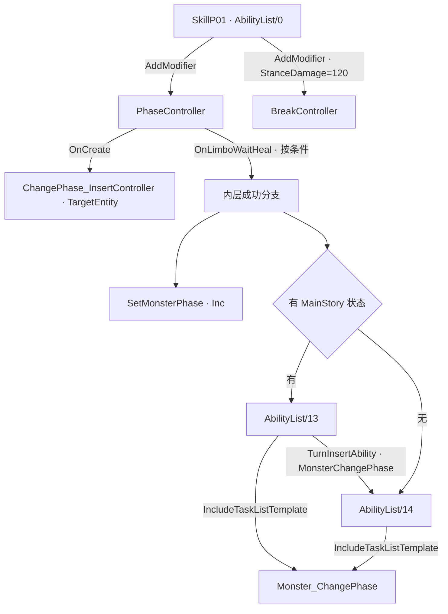

# DawnsEye 首领换相与挑战回合规则

本案追踪主线敌方实体 401501001 的阶段控制。另用 BattleEvent 1 核对关卡级回合规则的入口与敌方行为的共同配置结构。两个样本各自保留入口和作用域。

## 敌人、模板和参数

**Derived**。`ExcelOutput/StageConfig.json#/22705` 对应关卡 204310700，`MonsterList/0/Monster0=401501001`，`StageAbilityConfig=[]`。怪物行 `ExcelOutput/MonsterConfig.json#/1640` 通过 `MonsterTemplateID=4015010` 联到 `ExcelOutput/MonsterTemplateConfig.json#/356`，其 `JsonConfig` 指向 `Config/ConfigCharacter/Monster/Monster_W4_DawnsEye_00_Config.json`。这个怪物行同时独立携带 `AbilityNameList=["Monster_W4_DawnsEye_00_MainStory"]`。相邻基础怪物行 `ExcelOutput/MonsterConfig.json#/1639` 使用同模板，`AbilityNameList` 为空。变体之间共享模板，主线入口有单列证据。

`ExcelOutput/MonsterSkillConfig.json#/2089` 将技能 ID 401501011 接到 `SkillTriggerKey="SkillP01"`，其 `ParamList/5/Value=120`。角色文件 `Config/ConfigCharacter/Monster/Monster_W4_DawnsEye_00_Config.json#/SkillList/10` 的入口为 `Monster_W4_DawnsEye_00_PassiveSkillInitiate`。同配置 `DynamicValues/Floats/1405254526/ReadInfo` 明确读 SkillP01 参数 5，对应 Ability 的 `AddModifier.DynamicValues.StanceDamage`。参数绑定到实际状态写入前的输入 120，伤害及韧性算法另记 **Unknown**。 [上下文与参数](../05-context-expression/report.md)

## 状态与条件图

指针为 `Config/ConfigAbility/Monster/Monster_W4_DawnsEye_00_Ability.json` 内的静态定位。



- **Observed**。初始化定义 `/AbilityList/0/OnStart/7` 对 Caster 加 PhaseController，`/OnStart/17` 加 BreakController 并传入韧性参数。PhaseController 的 `Count=1`，`_CallbackList/0` 选择 `OnCreate`，定义 `ChangePhase_InsertController` 于 `ContextScope="TargetEntity"`。其第二个选择器是 `OnLimboWaitHeal`。
- **Derived**。 `/GlobalModifiers/MMonster_W4_DawnsEye_00_PhaseController/_CallbackList/1/CallbackConfig/3` 的分支先读取该键等于 0，再在成功子分支测试持有者 HP 小于等于 0。内层成功任务含重定义键为 1、`SetMonsterPhase(SetMode="Inc")`，以及按是否携带 `MMonster_W4_DawnsEye_00_MainStory` 选择插入目标。两条命名请求均有同文件定义，显式给出 `InsertAbilityPriority="MonsterChangePhase"` 与 `Mask_AliveOrLimbo`。
- **Observed**。主线注入定义 `/AbilityList/9` 对 Caster 加 MainStory、BreakPhase01、LowHPPhase01、LowHPPhase02 四个局部状态。两个 LowHP 状态都配置低于 0.3 的阈值，进一步以阶段 1 或 2 区分。阶段判定和 HP 判定是两个可单独查到的上下文输入。
- **Derived**。`/AbilityList/13/OnStart/1` 与 `/AbilityList/14/OnStart/9` 都具名包含全局候选模板。两条调用中的最小片段相同：

```json
{"$type":"RPG.GameCore.IncludeTaskListTemplate","Name":"Monster_ChangePhase"}
```

具名模板位于 `Config/ConfigGlobalTaskListTemplate/GlobalTaskListTemplate.json#/TaskListTemplate/0`。列表同时声明自定义事件、退出破韧、读取 MaxHP、`SetHP(ModifyRatio=1)`、重置韧性、刷新 UI 和添加/移除状态。首尾事件请求的原始二元组分别为 `{EnumIndex:4,Value:13}` 与 `{EnumIndex:4,Value:8}`，第一处显式有 `IncludeLimbo=true`。播放、修复、事件及逻辑在同一模板，模板字面依赖可确认，各步骤间完整可见顺序为 **Unknown**。 [自定义事件](../04-callback-trigger/report.md)

## 挑战事件的对照

**Derived**。`ExcelOutput/BattleEventConfig.json#/0/AbilityList/3` 直接列 `BattleEventAbility_ChallengeTurnLimit`。候选 `Config/ConfigAbility/BattleEventAbility.json#/AbilityList/9` 以 `OnAdd/0` 添加 `MCommon_ChallengeTurnLimit`。状态定义见 `Config/ConfigGlobalModifier/GlobalModifier_Common_Specific.json#/ModifierMap/MCommon_ChallengeTurnLimit`。其 `OnPhase1` 配 `Priority=-12`，包含 `LevelChallengeTurnAcc` 及独立判定任务。 `OnEnterBattle` 则配置 `ModifyActionDelay`。这里有跨文件具名候选和不同阶段的任务声明，内部计数、状态作用域注册、优先级 tie-break 均为 **Unknown**。

## 局部偏序与未解

上面的偏序由 `SuccessTaskList`、`FailedTaskList` 和调用目标约束。最低 HP 阈值涉及 `OnLimboWaitHeal`、主线专用状态阈值及破韧钩子等不同入口，配置不足以恢复全部同帧竞争。若两个阶段 Ability 都能静态到达公共模板，其每战实际执行次数仍取决于条件、标记和生命周期。已追踪的目标名在主体文件或公共模板索引可定位；跨资源装载、伤害提交与自定义事件派发相对时序保持 **Unknown**。

[Entity/Ability](../01-entity-ability/report.md) · [Modifier](../03-modifier/report.md) · [调度](../06-resource-scheduling/report.md)
