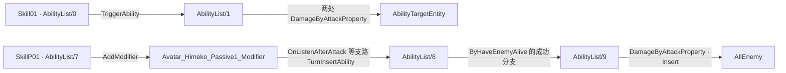

# 姬子的两段命中与天赋追击

本案比较角色 1003 的可选普攻、被动触发的追击，以及两路共享的伤害任务。关注目标、段权重与阶段钩子的配置证据。

## 主数据和参数

| 实证入口 | 配置联接 |
| --- | --- |
| `ExcelOutput/AvatarConfig.json#/2` | `AvatarID=1003`，`JsonPath` 指向姬子角色配置，普通攻击与天赋技能 ID 分别为 100301 与 100304 |
| `ExcelOutput/AvatarSkillConfig.json#/43` 与 `ExcelOutput/AvatarSkillConfig.json#/44` | `SkillTriggerKey="Skill01"`，等级 1 和 2 的参数 0 为 0.5、0.6 |
| `ExcelOutput/AvatarSkillConfig.json#/82` 与 `ExcelOutput/AvatarSkillConfig.json#/83` | `SkillTriggerKey="SkillP01"`，等级 1 参数为 0.7、3，等级 2 参数为 0.77、3 |
| `Config/ConfigCharacter/Avatar/Avatar_Himeko_00_Config.json#/SkillList/0` 和 `Config/ConfigCharacter/Avatar/Avatar_Himeko_00_Config.json#/SkillList/3` | 分别以 `EnemySelect` 和 `Caster` 选择目标，EntryAbility 分别为 `Avatar_Himeko_Skill01_Phase01`、`Avatar_Himeko_PassiveSkill01` |

**Derived**。同角色配置的 `DynamicValues/Floats` 中 -1126825319 对应 Skill01 参数 0，1246667513 对应 SkillP01 参数 0，-54401499 对应 SkillP01 参数 1，三个读取均明确给出 `ReadInfo.Type="SkillParam"`、`TriggerKey` 和 `Index`。前两者出现在普攻与追击的 `AttackData.DamagePercentage`，第三者是天赋回调内计数条件的比较值。 [参数与表达式](../05-context-expression/report.md)

## 配置图与任务

下图的边表示入口关联、具名请求或条件内的静态可达关系。Ability 的各指针属于 `Config/ConfigAbility/Avatar/Avatar_Himeko_00_Ability.json`。



**Observed**。普攻效果定义 `/AbilityList/1/OnStart/5` 与 `/AbilityList/1/OnStart/7` 给同一个 `AbilityTargetEntity` 传入火属性的 `AttackData`，共享伤害比例哈希，`HitSplitRatio` 分别是 0.4 与 0.6，命中特效也分段。其间 `/OnStart/6` 有 `WaitAnimState`，后两槽分别是 `DamagePerformFinish` 与 `SkillPerformFinish`。以第一段摘录为例：

```json
{
  "$type":"RPG.GameCore.DamageByAttackProperty",
  "TargetType":{"$type":"RPG.GameCore.TargetAlias","Alias":"AbilityTargetEntity"},
  "AttackProperty":{
    "$type":"RPG.GameCore.AttackData",
    "DamagePercentage":{"IsDynamic":true,"PostfixExpr":{"OpCodes":"AQAR","FixedValues":[],"DynamicHashes":[-1126825319]}},
    "HitSplitRatio":{"IsDynamic":false,"FixedValue":{"Value":0.4}}
  }
}
```

**Derived**。天赋入口 `/AbilityList/7/OnStart/0` 给 `Caster` 加局部 Modifier `Avatar_Himeko_Passive1_Modifier`。其 `_CallbackList/0` 选择 `OnListenAfterAttack`，先以 `ParamEntity` 和 `TeamLight` 判定来源并要求 `_Himeko_Attack=1`，再测试 `MDF_Pursuit_Layer` 等于天赋参数 1，继续要求有存活敌人以及持有者未带 `STAT_CTRL` 或 `DisableAction`。三个成功分支嵌套下的 `TurnInsertAbility` 指向 `Avatar_Himeko_Passive1Atk_Ability`，`AbilityTarget="AllEnemy"`、`InsertAbilityPriority="AvatarInsertAttackSelf"`，同时配置相应中止标记。源节点为 `Config/ConfigAbility/Avatar/Avatar_Himeko_00_Ability.json#/AbilityList/7/Modifiers/Avatar_Himeko_Passive1_Modifier/_CallbackList/0/CallbackConfig/0/SuccessTaskList/0/SuccessTaskList/0/SuccessTaskList/0`。

同 Modifier 列出入场、自定义事件、破韧、Modifier 移除、波次怪物和插入完成等选择器，表明路由具有多个入口。插入定义的 `/AbilityList/8/OnStart/0/SuccessTaskList/7` 在有存活敌人的分支显式请求 `Avatar_Himeko_Passive1Atk02_Ability`。该定义的 `/AbilityList/9/OnStart/0` 指名移除 `MAvatar_Himeko_00_Passive_Pursuit`，`/AbilityList/9/OnStart/7` 使用 `DamageByAttackProperty` 向 `AllEnemy` 传入 `AttackType="Insert"` 以及天赋参数 0。其 `/OnStart/8` 是伤害演出结束标记。

## 能确定的关系与残差

- **Derived**。回调内的插入请求依赖三层成功分支。请求目标中的后续 Ability 调用还依赖一个独立的存活敌人条件。以上是条件求值与指定任务的局部偏序。
- **Observed**。被动 `_CallbackList/6` 的 `OnInsertAbilityFinish` 和插入定义 `/AbilityList/8/OnInsertAbort/0` 都写 `_Himeko_Attack=1`。两个回收路径配置并存。事件发出与重入时点为 **Unknown**。
- **Inferred**。两路伤害复用同一接口。技能选择、天赋事件、目标范围、伤害类型与段显示由各自传入字段决定。两处配置的韧性哈希 1659254037、1182064154 在本案所查角色 `Floats` 中没有同名整数键，其求值及命中后的实际韧性、能量和死亡结算保留 **Unknown**。
- 两路局部 Ability 和 Modifier 名称均可在同文件定位。相机名从角色 `SkillAbilityList` 可继续查同名文件，镜头完成与命中等待之间的完整运行顺序未由本案例确定。

[Ability 分类](../01-entity-ability/report.md) · [伤害原语](../02-atomic-operations/report.md) · [监听粒度](../04-callback-trigger/report.md) · [调度](../06-resource-scheduling/report.md)
