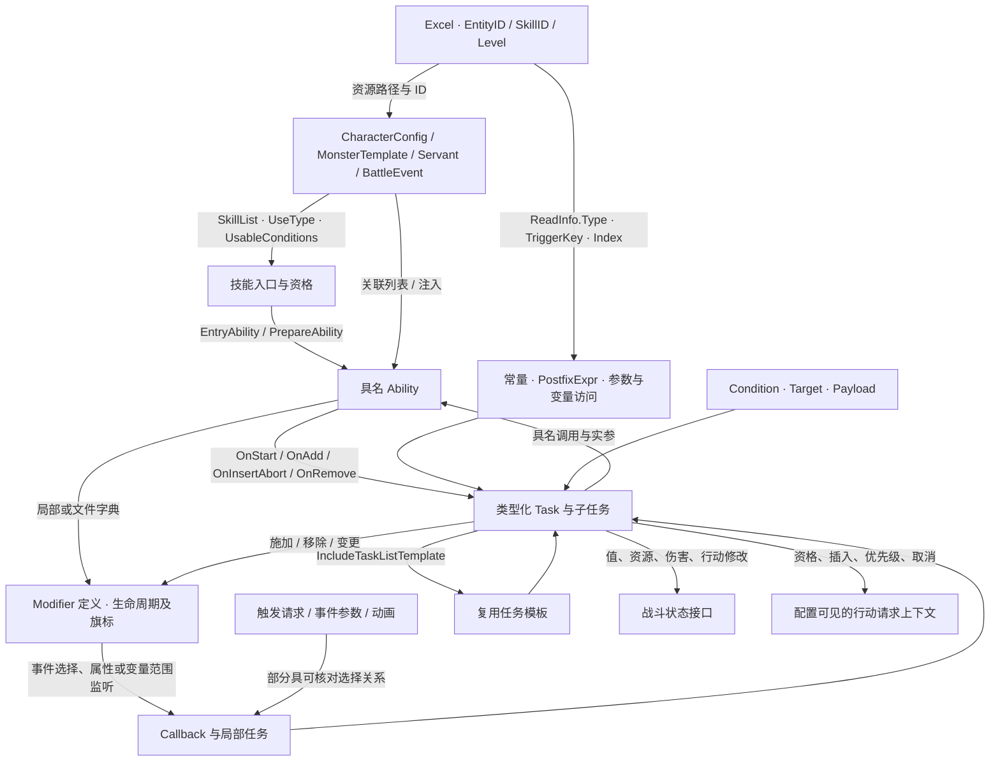

# 08 · 战斗配置语言与运行时抽象重建

## 配置模型

**Observed / Derived**。主数据按命名空间记录实体身份、技能号与等级参数。行为资产定义具名 Ability、状态及可复用模板。生命周期、回调和条件分支中的任务组合目标、参数、效果和后续请求。角色侧的技能成员关系与任务侧的执行请求皆可定位。同名资源的实际装载仍需独立证据。

图表示静态归属、引用和选定响应关系。Trigger 是多种触发结构承担的角色。动画等待、Ability 请求、数字自定义事件、属性范围监听各有载荷和配置位置。

- **Ability 分工。** `Config/ConfigCharacter/Avatar/Avatar_Asta_00_Config.json#/SkillAbilityList/0` 并列镜头、Phase01 和 Phase02。 `Config/ConfigAbility/Avatar/Avatar_Asta_00_Ability.json#/AbilityList/0/OnStart/1` 明文请求 Phase02。其任务树可追到伤害任务。姬子的独立 Ability 再由被动回调插入，同一伤害接口可以接受另一目标和参数。 [实体模型](../01-entity-ability/report.md) · [姬子](../07-case-studies/15-himeko-hit.md)
- **状态与持有者。** `Config/ConfigAbility/Avatar/Avatar_Robin_00_Ability.json#/GlobalModifiers/MAvatar_Robin_00_Skill03Area_sub_disableAction` 只声明 `{"BehaviorFlagList":["DisableAction"]}`，同文件其他状态对它施加并清理。艾丝妲的状态同时从施加点带入数值和寿命，由 `OnStack` 指定持有者属性。 [Modifier 样本](../03-modifier/evidence.jsonl)
- **事件桥。** `Config/ConfigGlobalTaskListTemplate/GlobalTaskListTemplate.json#/TaskListTemplate/0/TaskList/0` 发送 `{"EventType":{"EnumIndex":4,"Value":13},"IncludeLimbo":true}`。 `Config/GlobalConfig/GameCoreConstValue.json#/ModifierCustomEvents/8` 声明旗标 1006。 `Config/ConfigAbility/Avatar/Avatar_Nihilux_10_Ability.json#/AbilityList/16/Modifiers/MAvatar_Nihilux_10_SkillAeon_DirtyHP_Property/_CallbackList/1` 以事件来源和同一令牌过滤后配置写值。实际派发时点和参与者保留 Unknown。 [回调实证](../04-callback-trigger/report.md)

| 证据层次 | 模型内容 | 约束 |
| --- | --- | --- |
| Observed | 具名对象、类型化 Task、选择器、字典、条件、值形态及请求字段 | 从源位置直接回读 |
| Derived | 作用域内定义关系、显式参数绑定、分支结构、选定事件的字面桥 | 跨资源单一名字是候选，亦存在同名装备分支 |
| Inferred | 一次执行的上下文、状态应用与持有关联、事件参数载荷、待处理行动集合 | 能解释多角色样本。如何捕获身份及修改可见性未知 |
| Hypothesis | 图执行器、监听注册表、请求集合、调用帧、表现适配器 | 可以由统一执行器、编译结果或阶段内重算实现 |
| Unknown | 对象布局、任务原子提交、全局默认值、伤害公式、稳定排序、同帧与重入语义 | 缺少受控制的运行轨迹 |

## 原子化、正交性与扩展边界

“原子操作”采用任务槽口径。1,279 个类型中，235 种同时有 Avatar 与 Monster 行为资源样本，323 种至少出现一次字面 `TargetType`，97 种至少出现一次可定位的嵌套任务，18 种同时满足后两项。指标是类型层的存在性。它们辅助定位共享和复合接口，具体职责仍需对照原始节点。 [交叉统计](composition-shapes.tsv) · [类型位置](composition-witnesses.tsv)

| 维度 | 正证据与等级 | 限制或反例 |
| --- | --- | --- |
| 原子化 | Observed。`ModifySPNew`、`SetDynamicValue` 和 `RemoveModifier` 各可占单任务槽 | `FireWaveProjectile.PerProjectileDamage` 嵌入伤害任务，`AttackData` 还能并置伤害、韧性与表现。事务和中断语义未知 |
| 正交性 | Derived。`PredicateTaskList`、`TargetSequence` 和值表达式可分别替换分支、查询、效果输入 | `Retarget` 同时承载目标、过滤、随机、限制及任务执行。伤害修改监听也依赖上下文 |
| 参数化 | Derived。`ReadInfo` 绑定技能、行迹、星魂和装备，具名调用能带实参 | 同阶星魂哈希在不同角色共享，同名装备有不同序列化形态 |
| 组合与复用 | Derived。角色与敌方共享伤害任务，DawnsEye 请求公共换相模板，刻律德菈使用 Windfury | 模板和状态对调用作用域或同名策略有依赖 |
| 数据驱动 | Inferred。技能映射、资格、参数和边界策略可由不同配置节点控制 | 混淆类型、播放系统和底层操作实现仅见接口；无可读处理体时保持 Unknown |
| 事件驱动 | Derived。BP、负面状态与伤害监听可静态到达后续任务 | 范围监听、动画、直接生命周期钩子的规则与调用边界各异 |
| 生命周期 | Observed。存在创建、失效、叠层、步进、驱散及子状态字段 | 常规时长、跨施加者实例标识和自动清理顺序未知 |
| 上下文隔离 | Observed / Inferred。持有者、施加者、攻防、事件参数及 Scope 各有槽位 | 变量共享期限、对象快照和参数捕获规则未知 |
| 跨实体 | Derived。BattleEvent 和 Servant 通过各自 ID 关联，任务可向伙伴、召唤物或事件单位应用状态 | 景元创建任务和表中的 Team 取值不同，覆盖优先级未知 |
| 公共扩展 | Derived。目标字典、共享模板、公共 Modifier 和自定义令牌可给多角色与关卡复用 | 姬子新形态 Assist 视作战技、独立玩法的专用类型显示已暴露接口有适用边界 |

共享接口支持许多机制的配置组合。姬子新形态的配对映射、GridFight 的单例任务及实时玩法混淆操作也保留了特殊入口。具体实现可能由独立底层分支、共享执行器扩展或未导出的配置承载。命名、字段和出现位置不足以判定处理体。 [操作反例](../02-atomic-operations/report.md) · [实时玩法符号](../03-modifier/rt-symbol-candidates.tsv)

## 候选运行时架构

| Hypothesis | 可解释的配置 | 尚缺的区分证据 |
| --- | --- | --- |
| 同步子调用与阶段内遍历 | 嵌套子任务、同阶段具名调用、模板与参数转发 | 插入请求有预检、待处理计数及取消。同步模型还需某种可查询的延后状态和外部驱动 |
| 有序待处理集合 | 队首查询、下一未用行动查询、优先级、限额、取消 | FIFO、优先队列、分桶、排序视图均可实现这些谓词 |
| 执行帧与独立事件派发 | 具名请求参数、分离目标、阶段边界和当前槽位 | 是否用调用栈、栈外对象或上下文快照，需调查嵌套及挂起时的载荷行为 |
| 阶段/消息混合 | 行动值切换、插入、范围监听、动画和自定义事件及各自策略并存 | 需观测可区分带局部策略的统一调度与多个子机制的时序和资源轨迹 |

**最强调度结论。** `Config/ConfigAbility/Avatar/Avatar_RuanMei_00_Ability.json#/AbilityList/8/OnStart/0/Predicate` 是 `{"$type":"RPG.GameCore.ByIsFirstInsertAbilityInQueue","Inverse":true}`。其成功分支的表现事件证实有配置消费者使用该位置测试。Archer 另有下一请求和未用计数，白厄的插入前置限制同持有者请求数。可以推断有可查的待处理请求和多种策略入口。统一调度器的模块存在、数据结构、同优先级比较和可见时点仍为 **Unknown**。 [调度对照](../06-resource-scheduling/report.md) · [功能职责表](inventory.md)

## DSL 的表达能力

**Inferred**。这套序列化结构具备领域专用语言特征。行为节点可嵌套，支持独立目标查询、条件、数值表达式、局部与共享键、具名调用、事件选择、状态安装及清理。主数据和资源装载继续承担声明式配置，任务列表有位置序，条件树和调用关系又能形成带循环的静态行为图。表达式的有限静态求值与任务层结构是两层证据。即便复算命中符号与分支，也无法确定加载后是直接解释、翻译为中间指令、生成执行器或混合承载。 [求值](../05-context-expression/report.md) · [静态循环](../01-entity-ability/static-cycles.tsv)

## 研究边界

- **可确认。** 名字和作用域、类型化任务接口、具体参数绑定、显式条件和分支、选定事件筛选、资源操作与调度请求关系。
- **强推断。** 状态挂载形成跨阶段行为，具名 Ability 可组合复杂机制，技能复制案例主要可用重新发出行动请求解释。
- **多解及未知。** 同步边界、监听器注册和重入、上下文捕获、支付提交/回退、优先级、同帧结算与数值公式仍可有多个实现。未解析字面值及混淆配置逐专题记录。 [公共符号残差](../index/reference-overlay.tsv) · [调度请求残差](../06-resource-scheduling/unresolved-requests.tsv)
- **需要的新证据。** 源版本可比的公开或可授权执行轨迹，明确触发来源、入出待处理集合、参数快照、支付与退还事件、状态实例 ID、伤害中间量及时间点。它们可检验本报告的候选模型。

[案例总览](../07-case-studies/report.md) · [综合报告](../SUMMARY.md)
